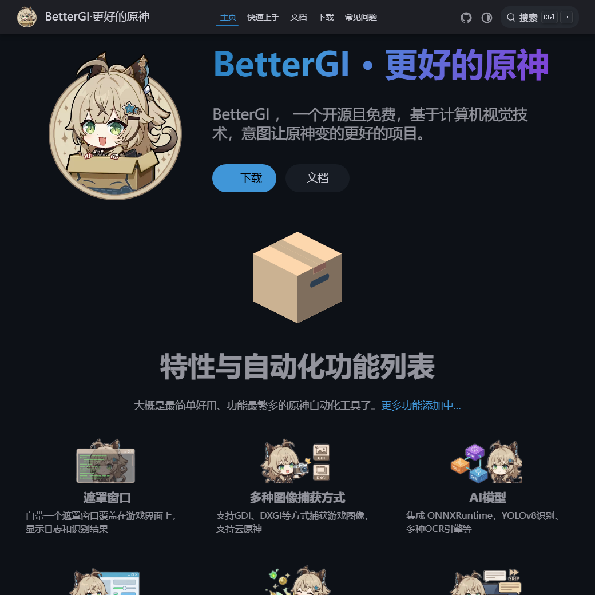
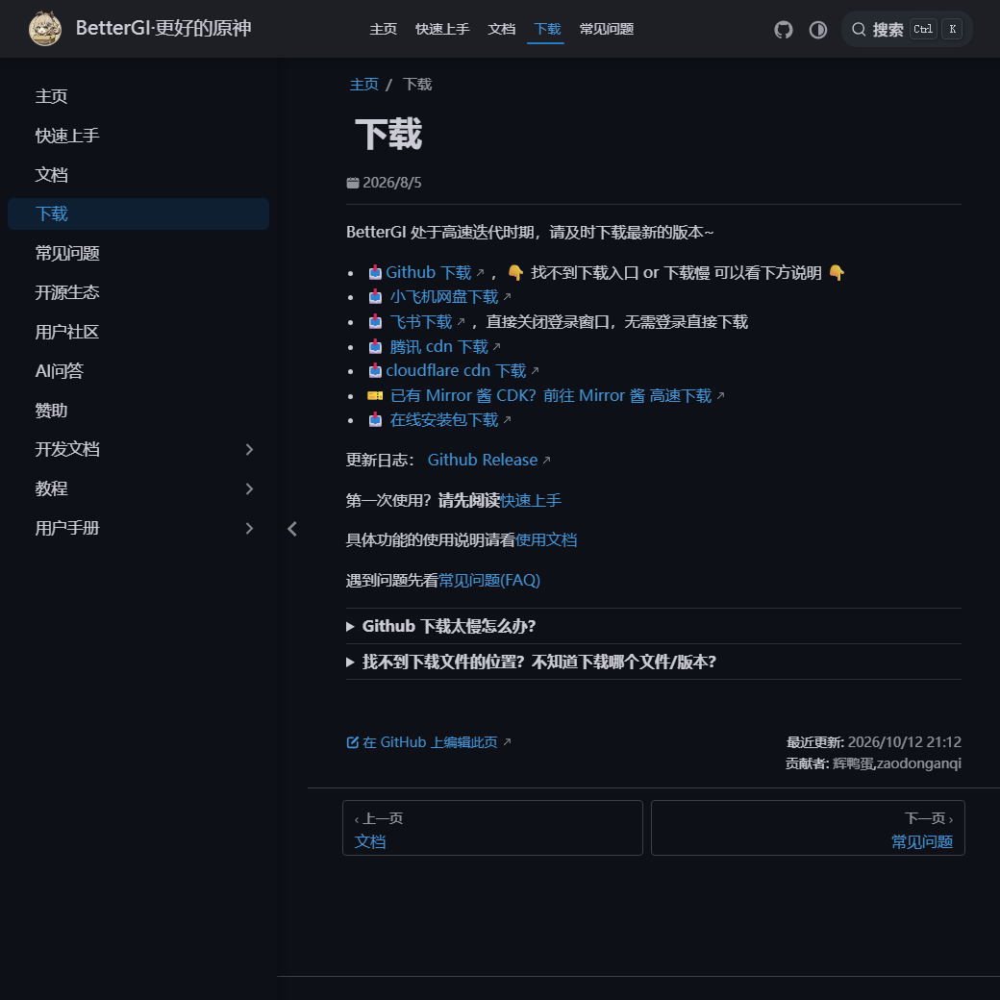

The most tiring part of Genshin Impact is not in the abyss, but in the actions that must be done every day without any fun: walking over, pressing F, clicking dialogue, collecting food, and handing in tasks. It adds up to less than half an hour, but you have to spend that half hour every day.

It is this segment that BetterGI wants to solve. It does not modify the game, nor does it draw cards for you. It just sits in front of the screen, looks at the screen, and then presses the keys for you.

## 1. How does it "see" the game?

This determines what it can do and why it sometimes fails, so let’s be clear:

- **Read-only screen** - Use GDI, DXGI or WindowsGraphicsCapture to capture images of the game window;
- **Recognition only** - built-in ONNXRuntime, uses YOLOv8 to recognize icons, and uses OCR to recognize text;
- **Keyboard and mouse only** - Send operations through simulated input.

No processes are injected, game files are not modified, and game memory is not read. This boundary is not only the foundation for it to confidently say "I'm just watching a screen", but it is also its fragile point: **if the picture changes, it becomes blind**. If the resolution is wrong, the filter is turned on, the brightness is adjusted, or the FPS overlay blocks a corner, the recognition will fail.

> [!NOTE]
> This is also its character - do it if you understand it, stop if you don't understand it. So don’t expect it to be as “absolutely accurate” as a plug-in. It is essentially an assistant with fast hands and good eyesight.

## 2. What can it do for you?

The number of functions is a bit exaggerated. Let’s pick the ones that are really used every day:

| Function | what to do | premise |
| --- | --- | --- |
| automatic picking | Identify the name of the dropped object, press F automatically, and set the black and white list | OCR is normal, don’t talk to NPC by mistake |
| automatic plot | Quickly click on the conversation, automatically select options, and skip the black screen | Simplified Chinese |
| automatic fishing | Fully automatic bait cutting, rod throwing, rod lifting and rod pulling | AI recognition, need to stabilize the picture |
| Automatic Summoning of the Seven Saints | Character invitations, weekly guests, etc., customizable card decks | Requires player level and deck |
| Auto battle/secret realm | Identify the team and automatically play according to the strategy | Secret Realm is based on Zhongli |
| Automatic logging | Hang up after equipping "Wang Shu Ruiyou" | Need to equip props first |
| Map tracking | Rely on mini-map for positioning, automatic collection and hoeing | route file |
| Daily finishing | Receive daily commission rewards and re-dispatch | Triggered when talking to Catherine |
| Quick transfer/automatic cooking/one-click enhancement | Automatic confirmation of teleport points; perfect area for cooking cards; one-click enhancement of holy relics | — |
| Keyboard and mouse recording | Record an operation and play it back | — |

There are basically two ways to use it: one is the "hang-up type", such as fishing, brushing, and logging, and you can do other things when you click it; the other is the "hand-saving type", such as picking up, plotting, and teleporting. You are still playing, but you don't have to press a bunch of repeated keys.

## 3. Download: Look for these points

@link[BetterGI 官网](https://www.bettergi.com/ "开源免费的原神自动化工具")

@link[GitHub Releases](https://github.com/babalae/better-genshin-impact/releases "所有历史版本都在这里")

@link[下载页（含国内镜像）](https://www.bettergi.com/download.html "GitHub 慢的时候看这里")

There are generally two types of packages available on GitHub, and there is no difference except the packaging method:

| document | what is | Suitable for whom |
| --- | --- | --- |
| `BetterGI.Install.0.66.0.exe` | Offline installation version, it will be updated automatically after installation. | Most people are too lazy to decompress |
| `BetterGI_v0.66.0.7z` | Portable version, unzip and run `BetterGI.exe` | Don’t want to install anything, or want to insert a USB flash drive |

0.66 is the version released on September 26, 2026. The installation package is about 481 MB and the portable package is about 444 MB - the size mainly comes from the built-in recognition model. It is in a period of high-frequency iteration. If you can release new ones, don’t release the old ones.

The download page of the official website also has several domestic images (Small Aircraft Network Disk, Feishu, Tencent CDN, Cloudflare CDN), as well as an online installation package `BetterGI.OnlineInst.exe`. When GitHub cannot be pulled, it is easier to use these.

> [!WARNING]
> This project is open source and free (GPL-3.0, all code is on GitHub). The official website writes very straightforwardly: ** Anyone who sells this software on any platform is a scammer. If you buy it, please refund it immediately and report it. ** The paid version of "Genshin Impact" you see on Xianyu and Taobao is mostly just a repackage of the compressed package here.

## 4. Can your computer run?

It only supports Windows, not mobile phones. Four hard requirements:

- [x] **64-bit** systems with Windows 10 or higher
- [x] [.NET 8 desktop runtime ](https://dotnet.microsoft.com/zh-cn/download/dotnet/thank-you/runtime-desktop-8.0.16-windows-x64-installer) (if not installed, you will be prompted to install it at startup)
- [ ] Administrator permissions - the game is run with administrator permissions. It cannot be run without an administrator.
- [ ] game set to `1920×1080`, Simplified Chinese, default brightness

The other two are easily overlooked: **There cannot be any picture filters** (HDR, N card filters, ReShade are all counted), **The DirectX layer cannot have other covering elements** - even the FPS number of MSI Afterburner may block an identification element.

The recommended configuration threshold is "medium image quality and stable 60 frames"; it can still be used if it does not reach this level, but some functions will be stuck.

## 5. First startup: three steps

**The first step is to adjust the game settings correctly. ** The language must be Simplified Chinese (other languages ​​are currently not supported), the resolution is 1920×1080, a full-screen window is acceptable, the brightness remains at default, and all filters are turned off.

**The second step is to click Start. ** Open the BetterGI main interface, click "Start", and it will automatically activate the Genshin Impact window. If you are using **Cloud Genshin Impact**, have multiple Genshin Impact in your computer, or are accustomed to using other launchers, remember to turn off "Start Genshin Impact at the same time" first.

**The third step is to use automatic pickup verification. **Don’t skip this step. Automatic pickup is turned on by default in its "Real-time Mission". Just find a collection station and see if it can press F on its own and see if there is an "Interaction or Pickup" log in the lower left corner. **If it passes, it means that the recognition and analog input are normal, and then turn on other functions. **

There are four ways to take screenshots, all of which are taken on the "Startup" page:

| Way | Features | when to use |
| --- | --- | --- |
| BitBlt | Best compatibility, worst performance | If any strange problem occurs, replace it first |
| DwmGetDxSharedSurface | Best performance, using undisclosed API | Pursue smoothness and accept occasional instability |
| WindowsGraphicsCapture | Ability to capture hardware overlays requires Win10 1903+ | **Yun Yuanshen can only use this** |
| WindowsGraphicsCapture（HDR） | One more layer of HDR support | Only use it when HDR is turned on in the game, otherwise the screen will be dark |

## 6. The four most likely places to get stuck on the first day

- **No response when double-clicking, or insufficient permissions. ** Under normal circumstances, UAC will pop up, select "Yes"; if it does not pop up, right-click and "Run as administrator".
- **English prompt "You must install or update .NET to run this application."** Missing .NET 8 When the desktop is running, just click the link above to install it.
- **The log is being refreshed, but there is no action in the game. ** Analog input is blocked by security software. 360. Windows Defender that has increased the interception intensity has blocked all of them, and BetterGI has been added to the whitelist or temporarily turned off.
- **Flurry screen, vertical stripes, and prompt that the Genshin Impact window cannot be found. ** Try another screenshot method and restart the game if necessary - some graphics card settings in Windows 11 will disable BitBlt.

## 7. Risk: This sentence cannot be omitted

Someone in the official website FAQ directly asked "Will my account be banned?", and the answer was this:

> Theoretically it will not be blocked. **BetterGI will not make any modifications to game files, read or write game memory, or any other behavior that harms the game itself. It relies solely on visual algorithms and simulation operations. ** But mhy is free, and the user terms clearly state that third-party software/simulation operations are one of the reasons for account ban. The current solution still has the possibility of being detected. I can only say that please use it in a low-key manner and please don’t jump in the face of the official website.

This is a very honest statement, and I don’t intend to tell you the truth. My understanding is: it does not touch the game itself, so the probability of being "technically judged as cheating" is relatively low; but it cannot get around the user agreement, and the final interpretation is not in your hands.

Therefore, it is your own judgment whether to use it and to what extent. If your account is of high value, don’t use it to do anything conspicuous; and don’t post screenshots or tutorials in the official community.

## 8. Is it worth it?

At the time of writing this article, this project has more than 17,000 stars and more than 1,300 forks on GitHub. It is written in C# and is GPL-3.0. If one person maintains it to this scale, it can be said that he is quite capable.

What it really gives is not to "play more content", but to eliminate repetitive work from the game. When you open Genshin Impact, you want to finish the game, watch the plot, and visit Teyvat, instead of going through the daily routine first. Whether it's worth it or not depends on how annoying you are for that half hour every day.

> [!TIP]
> If you encounter problems, first read [Documentation](https://www.bettergi.com/doc.html) and [FAQ](https://www.bettergi.com/faq.html), and then check GitHub Issues. The biggest fear of this kind of project is not bugs, but that no one will ask questions without reading the documentation.

It's open source, free, and powered by love. If you find it useful, go to GitHub and give it a star, which is more practical than anything else.
