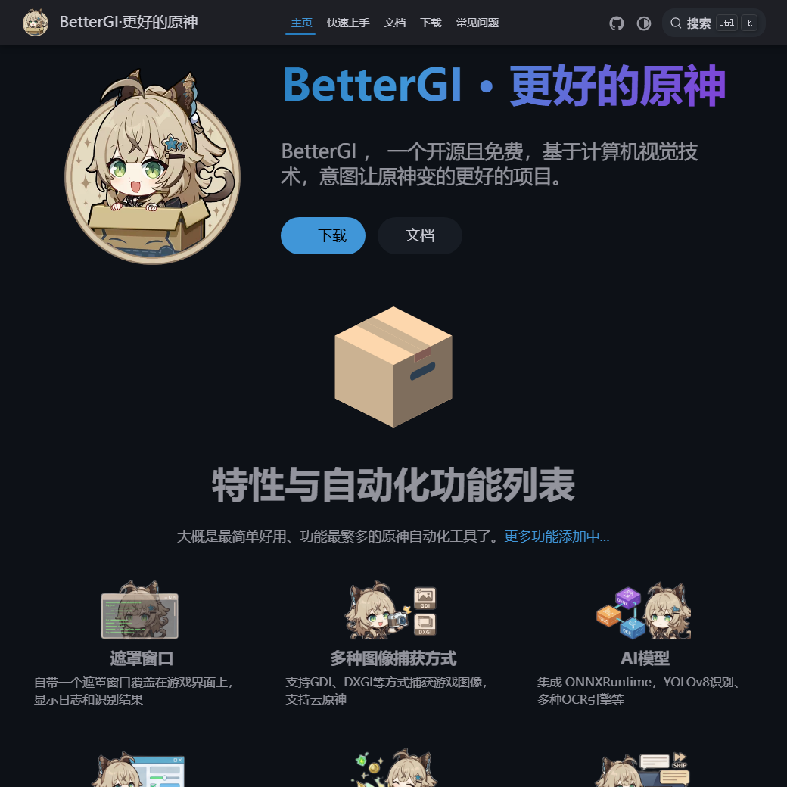
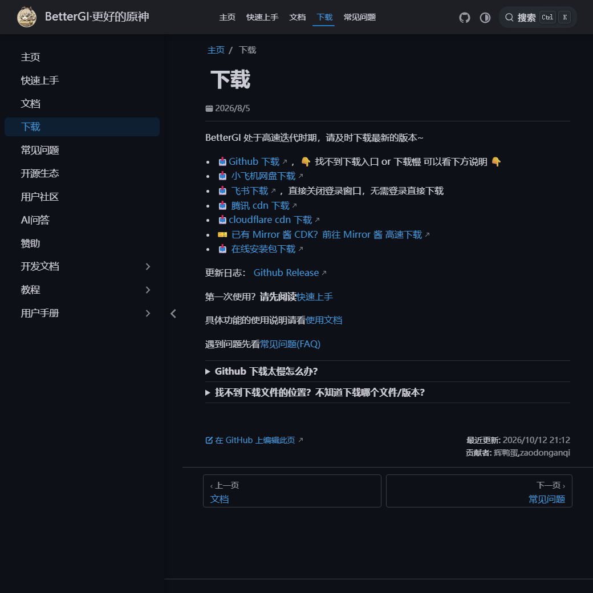

原神最累的地方不在深渊，而在每天那些必须做、又没有任何乐趣的动作：走过去、按 F、点对话、收菜、交委托。加起来不到半小时，但每天都得花这半小时。

BetterGI 想解决的正是这一段。它不修改游戏，也不会替你抽卡，只是坐在屏幕前面看着画面，然后帮你按该按的键。

## 一、它是怎么「看」游戏的

这一点决定了它能做什么、以及为什么它有时候会失灵，所以先说清楚：

- **只读画面**——用 GDI、DXGI 或 WindowsGraphicsCapture 抓游戏窗口的图像；
- **只做识别**——内置 ONNXRuntime，用 YOLOv8 认图标，用 OCR 认文字；
- **只按键盘鼠标**——通过模拟输入把操作发出去。

不注入进程、不改游戏文件、不读游戏内存。这条边界既是它能理直气壮说「我只是个看屏幕的」的底气，也是它脆弱的地方：**画面变了，它就瞎了**。分辨率不对、开着滤镜、亮度被调过、FPS 覆盖层挡住一角，都会让识别失败。

> [!NOTE]
> 这也是它的性格——看得懂就做，看不懂就停。所以别指望它像外挂那样「绝对准」，它本质上是一个手速很快、眼神很好的助手。

## 二、它能替你做什么

功能多到有点夸张，挑真正每天用得上的说：

| 功能 | 干什么 | 前提 |
| --- | --- | --- |
| 自动拾取 | 识别掉落物名称，自动按 F，可设黑白名单 | OCR 正常，别误对话 NPC |
| 自动剧情 | 快速点对话、自动选选项、跳过黑屏 | 简体中文 |
| 自动钓鱼 | 切饵、抛竿、提竿、拉条全自动 | AI 识别，需稳定画面 |
| 自动七圣召唤 | 角色邀请、每周来客等，可自定义卡组 | 需要牌手等级与卡组 |
| 自动战斗 / 秘境 | 识别配队，按策略自动打 | 秘境基于钟离 |
| 自动伐木 | 装备「王树瑞佑」后挂机 | 需先装备道具 |
| 地图追踪 | 靠小地图定位，自动采集、锄地 | 路线文件 |
| 日常收尾 | 领每日委托奖励、重新派遣 | 对话凯瑟琳时触发 |
| 快速传送 / 自动烹饪 / 一键强化 | 点传送点自动确认；烹饪卡完美区；圣遗物一键强化 | — |
| 键鼠录制 | 录一段操作，回放 | — |

它的用法基本是两种：一种是「挂机型」，比如钓鱼、刷本、伐木，点开就去干别的；一种是「省手型」，比如拾取、剧情、传送，你还在玩，只是不用再按那一堆重复的键。

## 三、下载：认准这几处

@link[BetterGI 官网](https://www.bettergi.com/ "开源免费的原神自动化工具")

@link[GitHub Releases](https://github.com/babalae/better-genshin-impact/releases "所有历史版本都在这里")

@link[下载页（含国内镜像）](https://www.bettergi.com/download.html "GitHub 慢的时候看这里")

GitHub 上一般提供两种包，除了打包方式没有任何区别：

| 文件 | 是什么 | 适合谁 |
| --- | --- | --- |
| `BetterGI.Install.0.66.0.exe` | 离线安装版，装完会自动更新 | 大多数人，懒得解压 |
| `BetterGI_v0.66.0.7z` | 便携版，解压后跑 `BetterGI.exe` | 不想装东西，或想塞进 U 盘 |

0.66 是 2026 年 9 月 26 日发布的版本，安装包约 481 MB，便携包约 444 MB——体积主要来自内置的识别模型。它正处于高频迭代期，**能下新的就别下旧的**。

官网下载页还挂着几个国内镜像（小飞机网盘、飞书、腾讯 CDN、Cloudflare CDN），以及一个在线安装包 `BetterGI.OnlineInst.exe`。GitHub 拉不动的时候，用这些更省事。

> [!WARNING]
> 这个项目是开源免费的（GPL-3.0，代码全在 GitHub 上）。官网写得很直白：**任何平台上卖这个软件的都是骗子，买了请立刻退款并举报。** 你在咸鱼、淘宝看到的「原神辅助」收费版，多半就是把这里的压缩包重新打包一遍。

## 四、你的电脑能不能跑

它只支持 Windows，手机端没有。四条硬要求：

- [x] Windows 10 或更高版本的 **64 位**系统
- [x] [.NET 8 桌面运行时](https://dotnet.microsoft.com/zh-cn/download/dotnet/thank-you/runtime-desktop-8.0.16-windows-x64-installer)（没装的话，启动时会提示你去装）
- [ ] 管理员权限——游戏是管理员权限跑的，它不管理员就跑不动
- [ ] 游戏设为 `1920×1080`、简体中文、默认亮度

另外两条容易被忽略：**不能有任何画面滤镜**（HDR、N 卡滤镜、ReShade 都算），**DirectX 层不能有别的遮盖元素**——连 MSI Afterburner 的 FPS 数字都可能挡掉一个识别要素。

推荐配置的门槛是"中画质能稳 60 帧"；达不到也能用，只是部分功能会卡。

## 五、第一次启动：三步

**第一步，先把游戏设置调对。** 语言必须是简体中文（目前不支持其他语言），分辨率 1920×1080，全屏窗口都行，亮度保持默认，滤镜全关。

**第二步，点启动。** 打开 BetterGI 主界面，点「启动」，它会自动激活原神窗口。如果你用的是**云原神**、电脑里有多个原神、或者习惯用别的启动器，记得先关掉「同时启动原神」。

**第三步，用自动拾取验证。** 这一步别跳。它的「实时任务」里自动拾取默认开着，随便找个采集物站边上，看它会不会自己按 F、左下角有没有"交互或拾取"的日志。**它通了，说明识别和模拟输入都正常，再去开别的功能。**

截图方式有四种，都在「启动」页里切：

| 方式 | 特点 | 什么时候用 |
| --- | --- | --- |
| BitBlt | 兼容性最好，性能最差 | 出任何怪问题，先换回它 |
| DwmGetDxSharedSurface | 性能最好，用了未公开 API | 追求流畅，能接受偶发不稳 |
| WindowsGraphicsCapture | 能抓到硬件叠加层，需 Win10 1903+ | **云原神只能用这个** |
| WindowsGraphicsCapture（HDR） | 多一层 HDR 支持 | 仅在游戏开了 HDR 时用，否则画面发暗 |

## 六、第一天最容易卡住的四处

- **双击没反应，或者权限不够。** 正常情况下会弹 UAC，选「是」；没弹就右键「以管理员身份运行」。
- **弹英文提示 “You must install or update .NET to run this application.”** 缺 .NET 8 桌面运行时，按上面的链接装一遍就好。
- **日志在刷，但游戏里没动作。** 模拟输入被安全软件拦了。360、调高了拦截强度的 Windows Defender 都拦过，把 BetterGI 加白名单或者临时关掉。
- **花屏、竖条纹、提示找不到原神窗口。** 换一种截图方式试试，必要时重启游戏——Windows 11 部分显卡设置会让 BitBlt 失效。

## 七、风险：这句不能省

官网 FAQ 里有人直接问「会不会封号」，回答是这个：

> 理论上不会被封。**BetterGI 不会做出任何修改游戏文件、读写游戏内存等任何危害游戏本体的行为，单纯依靠视觉算法和模拟操作实现。** 但是 mhy 是自由的，用户条款上明确说明第三方软件/模拟操作是封号理由之一。当前方案还是存在被检测的可能。只能说请低调使用，请不要跳脸官方。

这段话说得很诚实，也没打算替你兜底。我的理解是：它确实不碰游戏本体，所以「技术上被判定为作弊」的概率相对低；但用户协议那一关它绕不过去，**最终解释权不在你手里**。

所以要不要用、用到什么程度，是你自己的判断。账号价值高的，别拿它去做任何显眼的事；也别在官方社区里发截图、发教程。

## 八、值不值

写这篇文章时，这个项目在 GitHub 上有 1.7 万多 star、1300 多个 fork，用 C# 写的，GPL-3.0。一个人维护到这个规模，可以说是相当能打了。

它真正给的，不是"多玩到内容"，而是**把重复劳动从游戏里剔出去**。你打开原神的时候，是想去刷本、去看剧情、去逛提瓦特，而不是先清一遍日常。这件事值不值，取决于你每天那半小时有多烦。

> [!TIP]
> 遇到问题先看[文档](https://www.bettergi.com/doc.html)和 [FAQ](https://www.bettergi.com/faq.html)，再翻 GitHub Issue。这类项目最怕的不是 bug，是没人看文档就来提问。

它是开源、免费的，靠爱发电。用得顺手的话，去 GitHub 点个 star，比什么都实在。
