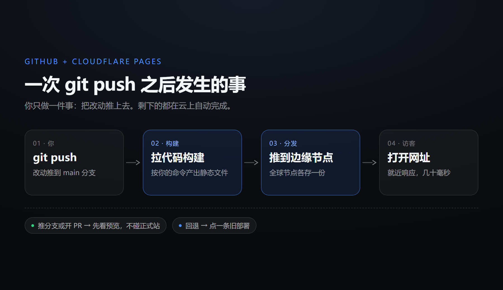
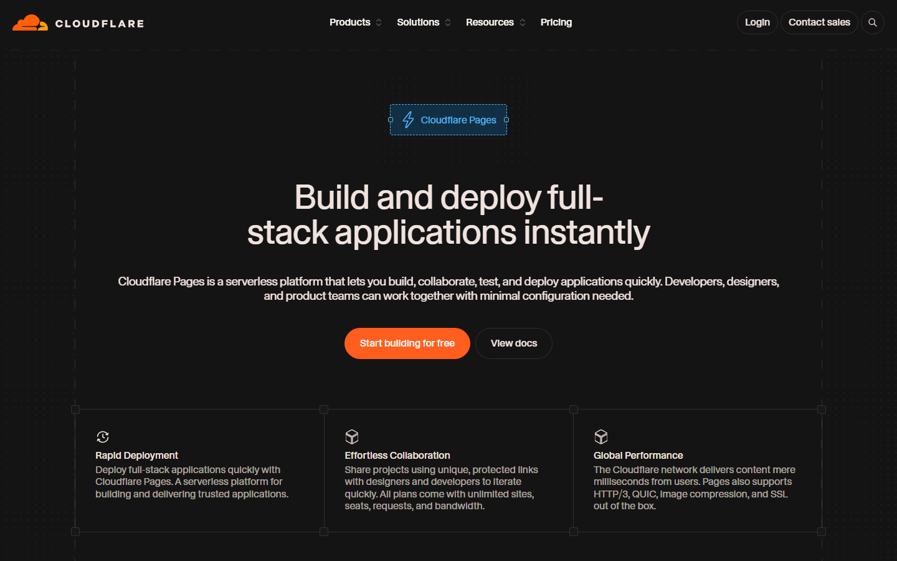

The page you are reading is the product of a `git push`.

There is no server, no pagoda panel, and no "database connection failed" email received in the middle of the night. After writing the words, changing the style, submitting, and pushing, the URL will be new in a few dozen seconds. This article is about this link - why it was established, where the free quota is, and which step is most likely for newbies to get stuck.

## 1. Division of labor: one saves, one sends

This combination actually only does two things:

- **GitHub is responsible for "storage"** - articles, pictures, and templates are all files in the warehouse. Each submission is a complete snapshot, and you can go back to any day if something goes wrong.
- **Cloudflare Pages is responsible for "publishing"** - connect to the warehouse, automatically pull the code, build, and push the product to global edge nodes for each push.

The key understanding is here: **Static blogs do not need to be "run", they only need to be "sent to the place closest to the readers"**. HTML, CSS, images, and JS are all files and do not require a database or resident process. Since there is nothing to run, there is no need for a machine that is always on - which is exactly what CDNs are good at.

@link[Cloudflare Pages Documentation](https://developers.cloudflare.com/pages/ "构建、部署、自定义域、Functions 的官方说明")

## 2. What happens after a push



1. **Trigger** - GitHub receives a push and notifies Cloudflare that the warehouse has changed.
2. **Build** - Cloudflare pulls the code into the temporary container, runs the commands you set (`hugo`, `npm run build`, no need to run anything for a pure static site), and produces a directory such as `dist/`.
3. **Distribution** - The product is uploaded to the edge network, and each of the more than 300 nodes around the world stores a copy.
4. **Switch** - The new version takes effect atomically, and the old version remains in the deployment history.

Step 4 is more important than it sounds: **The old version is still online when the build fails**, and readers will not see a half-finished white page. This is difficult to achieve by setting up a server by yourself - `git pull` Halfway through, if the dependency fails, the website will really crash.

## 3. Why not use GitHub Pages directly?

GitHub Pages can also do this, and I first moved from it. The difference lies in these points:

| Comparative item | GitHub Pages | Cloudflare Pages |
| --- | --- | --- |
| bandwidth | 100 GB/month (soft limit) | No limit |
| build | 10 times/hour (soft limit) | 500 times/month |
| Deployment timeout | 10 minutes | 20 minutes |
| Preview deployment | none | One link per branch |
| rollback | revert re-push | Click |
| backend function | none | Pages Functions |
| Private warehouse | The free version does not support | support |

The conclusion is not complicated: **pure documentation, few pictures, and little traffic, GitHub Pages is completely sufficient** and requires less configuration. But once you need to "watch the preview before going online", need one-click rollback, or need several interfaces, Pages saves time.

## Four and three steps to go online

### Step 1: Warehouse

Create a new warehouse and push the site files up. The directory of a purely static site may look like this:

```
my-site/
├─ index.html
├─ assets/
│   ├─ style.css
│   └─ app.js
├─ posts/
│   └─ hello/index.html
└─ robots.txt
```

Just use the generator (Hugo, Astro, Hexo) to push the source code. The product is generated by the build command, `dist/` and `node_modules/` are written into `.gitignore`.

### Step 2: Connect Pages

Console → Workers and Pages → Create → Pages → Connect to Git repository. Fill in the construction parameters according to the site type:

| site type | Build command | Output directory |
| --- | --- | --- |
| Pure HTML | Leave blank | `/` |
| Hugo | `hugo` | `public` |
| Astro / Vite | `npm run build` | `dist` |
| Next.js (static export)| `npm run build` | `out` |

It's okay to select None by default for the framework. The principle is to "run the command and get the directory". You don't need it to make decisions for you.

### Step 3: Bind domain name

If the domain name is already hosted on Cloudflare, just add a CNAME and the certificate will be automatically issued without touching Let's Encrypt. Then turn on Always Use HTTPS and redirect `www` to the naked domain.

> [!TIP]
> Spend two minutes going through the following items before going online, which can save half of the troubleshooting time later.

- [ ] The home page can be opened, but the console does not get 404
- [ ] Click on any article and it can still be opened after refreshing.
- [ ] There is no case error in the image path
- [ ] Typesetting is normal in mobile phone width
- [ ] has `404.html` or SPA fallback rules
- [ ] `robots.txt` and `sitemap.xml` are accessible

## 5. Where is the free quota?



Writing down the number is more useful than just saying "free":

| project | Free version |
| --- | --- |
| Number of builds | 500 times per month, only running 1 at a time |
| Single build timeout | 20 minutes |
| Number of site files | 20,000 |
| Single file size | 25 MiB |
| bandwidth/request | No limit |
| Custom domain name | 100 pcs per item |
| Number of items | 100 per account |

500 times spreads out to 16 times per day, which is more than enough for a blogger - unless you submit once every time you press save. What you really need to pay attention to is the **single file size of 25 MiB**: this upper limit determines that it cannot be used as a picture bed or video site. A ten-minute screen recording can be enough.

> [!WARNING]
> If a single file exceeds 25 MiB, the build will directly fail. The same applies if the total number of files exceeds 20,000. Videos and large compressed files should be placed in R2 or object storage, and only links should be left on the page.

## Six or four pits, almost everyone has stepped on them

**1. The output directory is filled in incorrectly. **
The build is successful but the page is 404, 90% of the time it is here. For purely static sites, fill in `/`, for Hugo, fill in `public`, and for Vite, fill in `dist`. The product is actually in `dist`, but the root directory is filled in as the output directory, and it is completely blank when deployed.

**2. Refresh sub-page 404. **
The routing of SPA is on the front end, and there is no `/posts/hello` file on the server at all. Add a `_redirects`:

```
/*    /index.html   200
```

This is an internal rewrite rather than a jump, and the address bar will not change. For multi-page static sites, you should create a `404.html`. Don’t use this rule - it will turn the real 404 into the homepage, and the search engine will mark you down.

**3. Uppercase and lowercase. **
While native Windows does not differentiate between `Logo.PNG` and `logo.png`, Cloudflare's build environment is Linux, which does. There are good local pictures, but all the online pictures are bad. This is basically the reason.

**4. Chinese file name. **
The Chinese path can be used, but the encoding must be consistent before and after. Written locally `我的图.png`, it may become URL-encoded after construction, and the reference will not change accordingly, resulting in 404. The easiest way to save trouble is to always use lowercase English letters and hyphens in the file names.

> [!IMPORTANT]
> If the build fails, don’t rush to change the code. Look at the last twenty lines in the deployment log. Most of the time it's because the Node version is wrong, or `package-lock.json` and `package.json` are out of sync.

## 7. Three underrated functions

**Preview deployment. ** Push a branch or open a PR, Cloudflare will give it an independent URL and use the same build process. Check the preview link first for the revision, and then merge it into the main branch if you are satisfied. This is what I always do when I adjust the layout—you can click on it on your mobile phone to know if it’s right, so you don’t have to use the online site as a testing ground.

**One-click rollback. ** Each record in the deployment list can be "Rollback to this deployment". If the style changes, don’t rush to revert. Roll back to the previous version first, and then slowly fix it.

**`_headers`. ** Cache and response headers are effective when written in a plain text file:

```
/assets/*
  Cache-Control: public, max-age=31536000, immutable

/*
  X-Content-Type-Options: nosniff
  Referrer-Policy: strict-origin-when-cross-origin
```

Static resources are cached for a long time, HTML is not cached, and the first screen will be significantly faster.

## 8. When is it not enough?

If any of the following occurs, Pages is inappropriate:

- Requires database (comments, likes, users)
- Long connection required (chat, collaboration, real-time notifications)
- Requires scheduled tasks or background queues
- Requires login authentication and uploading files

These all require "stateful servers". Cloudflare's answer is Workers plus D1 / Durable Objects / R2 - the same account, the same set of deployment feel, but the carrier is changed from static hosting to edge functions. Another project of mine needs to run network disk programs on Cloudflare, and this is the case: Pages can't even build, so Workers must be used.

## 9. Finally

The real threshold for this solution is not technology. Building a warehouse, connecting to Pages, and binding a domain name can be done in half an hour. The hard part is getting used to it: **Accept that "content is a document" and accept that every change must be submitted**.

Once you accept it, you'll get a great deal in exchange - every version of this website is there, and you can go back to it any day to see what was written and what was changed. Anyone who writes knows that this feeling of "can go back" is worth more than the little server money saved.

@link[GitHub Pages usage restrictions](https://docs.github.com/en/pages/getting-started-with-github-pages/github-pages-limits "官方给出的 1 GB 站点上限、100 GB 月流量等软限制原文")
