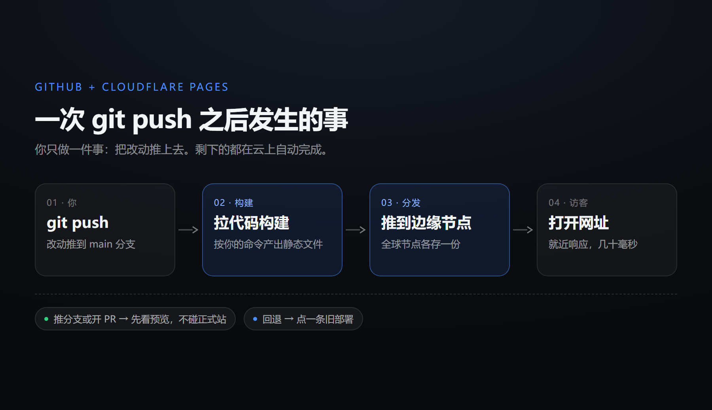
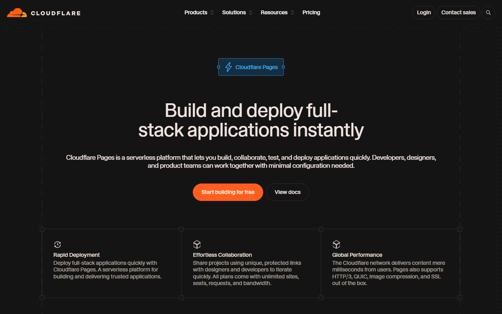

你正在读的这个页面，就是一次 `git push` 的产物。

没有服务器，没有宝塔面板，也没有半夜收到「数据库连接失败」的邮件。写完字，改完样式，提交、推送，几十秒后网址已经是新的。这篇文章讲的就是这条链路——它为什么成立、免费额度到底在哪、新手最容易在哪一步卡住。

## 一、分工：一个存，一个发

这套组合其实只干两件事：

- **GitHub 负责「存」**——文章、图片、模板全是仓库里的文件。每次提交都是一个完整快照，写坏了能回到任意一天。
- **Cloudflare Pages 负责「发」**——连上仓库，每次推送自动拉代码、构建、把产物推到全球边缘节点。

关键认知在这里：**静态博客不需要「运行」，只需要「被送到离读者最近的地方」**。HTML、CSS、图片、JS 都是文件，不需要数据库，也不需要常驻进程。既然不需要运行，就不需要一台一直开着的机器——这恰好是 CDN 擅长的事。

@link[Cloudflare Pages 文档](https://developers.cloudflare.com/pages/ "构建、部署、自定义域、Functions 的官方说明")

## 二、一次 push 之后发生了什么



1. **触发**——GitHub 收到推送，通知 Cloudflare 这个仓库变了。
2. **构建**——Cloudflare 在临时容器里拉代码，跑你设置的命令（`hugo`、`npm run build`，纯静态站什么都不用跑），产出 `dist/` 之类的目录。
3. **分发**——产物上传到边缘网络，全球三百多个节点各存一份。
4. **切换**——新版本原子生效，旧版本留在部署历史里。

第四步比听起来重要：**构建失败时线上还是旧版本**，读者不会看到半成品白页。这一点自己搭服务器反而难做到——`git pull` 到一半、依赖装崩了，网站就真的挂了。

## 三、为什么不直接用 GitHub Pages

GitHub Pages 也能干这事，最早我就是从它搬过来的。区别在这几处：

| 对比项 | GitHub Pages | Cloudflare Pages |
| --- | --- | --- |
| 带宽 | 100 GB/月（软限） | 不限 |
| 构建 | 10 次/小时（软限） | 500 次/月 |
| 部署超时 | 10 分钟 | 20 分钟 |
| 预览部署 | 无 | 每分支一条链接 |
| 回滚 | revert 重推 | 点一下 |
| 后端函数 | 无 | Pages Functions |
| 私有仓库 | 免费版不支持 | 支持 |

结论不复杂：**纯文档、图少、流量小，GitHub Pages 完全够用**，配置还更少。但你一旦需要「先看预览再上线」、需要一键回滚、需要几个接口，Pages 省下的是时间。

## 四、三步上线

### 第一步：仓库

新建仓库，把站点文件推上去。纯静态站的目录大概长这样：

```
my-site/
├─ index.html
├─ assets/
│   ├─ style.css
│   └─ app.js
├─ posts/
│   └─ hello/index.html
└─ robots.txt
```

用生成器（Hugo、Astro、Hexo）的话推源码就行，产物由构建命令生成，`dist/` 和 `node_modules/` 写进 `.gitignore`。

### 第二步：连 Pages

控制台 → Workers 和 Pages → 创建 → Pages → 连接 Git 仓库。构建参数按站点类型填：

| 站点类型 | 构建命令 | 输出目录 |
| --- | --- | --- |
| 纯 HTML | 留空 | `/` |
| Hugo | `hugo` | `public` |
| Astro / Vite | `npm run build` | `dist` |
| Next.js（静态导出）| `npm run build` | `out` |

框架预设选 None 也行，原理就是「跑命令、拿目录」，不需要它替你做决定。

### 第三步：绑域名

域名已经在 Cloudflare 托管的话，加一条 CNAME 就完事，证书自动签发，不用碰 Let's Encrypt。再打开 Always Use HTTPS，顺手把 `www` 重定向到裸域。

> [!TIP]
> 上线前花两分钟过一遍下面这几项，能省掉后面一半的排查时间。

- [ ] 首页能打开，控制台没有 404
- [ ] 点进任意一篇文章，刷新后仍然能打开
- [ ] 图片路径没有大小写错误
- [ ] 手机宽度下排版正常
- [ ] 有 `404.html` 或 SPA 回退规则
- [ ] `robots.txt` 和 `sitemap.xml` 能访问

## 五、免费额度到底在哪



写清数字，比只说「免费」有用：

| 项目 | 免费版 |
| --- | --- |
| 构建次数 | 每月 500 次，同时只跑 1 个 |
| 单次构建超时 | 20 分钟 |
| 站点文件数 | 20,000 个 |
| 单文件大小 | 25 MiB |
| 带宽 / 请求 | 不限 |
| 自定义域名 | 每项目 100 个 |
| 项目数 | 每账户 100 个 |

500 次摊到每天是 16 次，对写博客的人绰绰有余——除非你每按一次保存就提交一回。真正要留意的是**单文件 25 MiB**：这个上限决定了它当不了图床或视频站，一段十分钟的录屏就能顶满。

> [!WARNING]
> 单文件超过 25 MiB 会直接构建失败，总文件数超过两万同理。视频和大压缩包应该放 R2 或对象存储，页面上只留链接。

## 六、四个坑，几乎人人踩一遍

**一、输出目录填错。**
构建成功但页面 404，九成是这里。纯静态站填 `/`，Hugo 填 `public`，Vite 填 `dist`。产物其实在 `dist`、却把根目录填成输出目录，部署上去就是一片空白。

**二、刷新子页面 404。**
SPA 的路由在前端，服务器上根本没有 `/posts/hello` 这个文件。加一个 `_redirects`：

```
/*    /index.html   200
```

这是内部重写而不是跳转，地址栏不会变。多页静态站则应该做一个 `404.html`，别用这条规则——它会把真正的 404 也变成首页，搜索引擎会记你一笔。

**三、大小写。**
本地 Windows 不区分 `Logo.PNG` 和 `logo.png`，Cloudflare 的构建环境是 Linux，区分。本地好好的图、线上全是破图，基本都是这个原因。

**四、中文文件名。**
中文路径能用，但必须前后编码一致。本地写 `我的图.png`，构建后可能变成 URL 编码形式，引用没跟着变就 404。省事的做法是文件名一律英文小写加连字符。

> [!IMPORTANT]
> 构建失败先别急着改代码，去部署日志里看最后二十行。绝大多数是 Node 版本不对，或者 `package-lock.json` 和 `package.json` 不同步。

## 七、三个被低估的功能

**预览部署。** 推一个分支或开一个 PR，Cloudflare 会给它一条独立网址，用的是同一套构建流程。改版先在预览链接上看，满意了再合进主分支。我调排版时一直这么干——手机上点开就知道对不对，不用拿线上站当试验田。

**一键回滚。** 部署列表里每条记录都能「Rollback to this deployment」。样式改崩了不用急着 revert，先滚回上一个版本，再慢慢修。

**`_headers`。** 缓存和响应头写在一个纯文本文件里就生效：

```
/assets/*
  Cache-Control: public, max-age=31536000, immutable

/*
  X-Content-Type-Options: nosniff
  Referrer-Policy: strict-origin-when-cross-origin
```

静态资源长缓存、HTML 不缓存，首屏会明显快一截。

## 八、它什么时候不够用

出现下面任意一条，Pages 就不合适了：

- 需要数据库（评论、点赞、用户）
- 需要长连接（聊天、协作、实时通知）
- 需要定时任务或后台队列
- 需要登录鉴权、上传文件

这些都要「有状态的服务端」。Cloudflare 的答案是 Workers 加 D1 / Durable Objects / R2——同一个账户、同一套部署手感，只是载体从静态托管换成边缘函数。我另一个项目要在 Cloudflare 上跑网盘程序，就属于这种情况：Pages 连构建都过不了，必须用 Workers。

## 九、最后

这套方案的真正门槛不是技术。建仓库、连 Pages、绑域名，半小时能做完。难的是习惯：**接受「内容即文件」，接受每次改动都要提交一次**。

一旦接受，你会换回一件很划算的东西——这个网站的每一版都在，任何一天都能翻回去看当时写了什么、改了什么。写字的人都懂，这种「可以回头」的感觉，比省下的那点服务器钱值钱。

@link[GitHub Pages 使用限制](https://docs.github.com/en/pages/getting-started-with-github-pages/github-pages-limits "官方给出的 1 GB 站点上限、100 GB 月流量等软限制原文")
