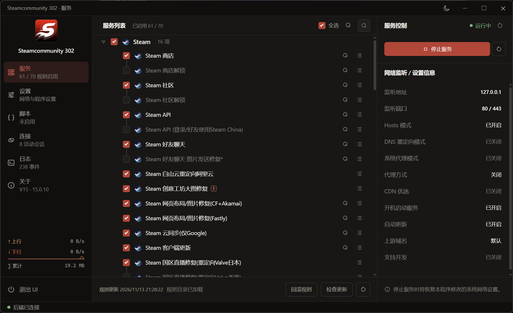

Original source:

@link[Steamcommunity 302](https://www.dogfight360.com/blog/18682/)

Steamcommunity 302 (referred to as S302), developed and maintained by Dogfight360, is a free, cross-platform local anti-generation tool. It is mainly used to solve network problems such as Steam community, creative workshop, personal profile page access errors (118/105, etc.), slow loading, picture cracking and other network problems in the domestic environment. It also supports network optimization of some sites such as GitHub, Discord, EA, etc., and supports Windows, macOS, Linux / SteamDeck Runs on all platforms.

## ✨ Core Functions

Steam series network repair

The Steam store, community, personal homepage, and friend chat pictures are reversely repaired;

Creative workshop large picture repair, web page layout picture repair;

Steam API mode switching, distinguishing between national SteamChina and global login environments;

CDN automatically optimizes, automatically tests speed and selects low-latency nodes to improve 502 and slow loading problems.

Multiple working modes

Hosts mode: Modify system hosts and take effect globally;

DNS redirection mode (NetFilterSDK/WinDivert driver), accepts DNS requests without changing the hosts file;

PAC proxy mode is suitable for users who do not want to modify hosts;

The interface-less service runs in the background, supports self-starting at boot, and allows the tray to quickly start and stop services.

Certificates and Network Management

Self-signed root certificates are automatically installed/exported/reset to resolve HTTPS certificate insecurity errors;

Port occupancy detection, hosts automatic backup, log viewing, traffic visualization;

UserScript (UserScript) support, expandable custom rules (new in V15).

Cross-platform adaptation

Windows：x86‑64 / ARM64；

macOS：Intel、Apple Silicon；

Linux: AppImage, deb, rpm packages, natively adapted to SteamDeck handheld game mode;

Supports GUI-free pure command line backend deployment, and the server environment can be run in cli mode.

## 📋 Main update highlights of V15 version (Ver.15.0.10)

Added UserScript script extension capability;

Linux provides deb/rpm official installation package, adapted to DroidDeck;

Added login risk warning for SteamDeck when opening SteamAPI;

Fixed a large number of bugs such as Ubuntu certificate import, macOS hibernation and wake-up lag, certificate generation failure, etc.;

DNS redirection switches to the NetFilterSDK driver by default, supporting Windows ARM architecture;

Improve the complete uninstall process to avoid residual hosts, certificates, and system service junk files.

## ⚠️ Common pitfalls and precautions

SteamDeck/Linux infinite loop login. Turning on the Steam API option will cause the new version of Steam client to be stuck in login. Just turn off this option. If the terminal is stuck, you can solve it by modifying the configuration file or disabling the s302 service and restarting the device.

Windows security software reports PUA/accidentally deleted files. The tool will modify hosts, install root certificates, and register system drivers. Windows Defender can easily determine it as PUA. You need to manually add directory exclusions or allow the program in the protection history. Do not decompress and place it in the Program Files directory, as this will trigger an R6025 runtime error. It is recommended that you decompress it to a normal directory on drive D.

Conflict with other network tools There will be compatibility issues when coexisting with mihomo, Tinder, and Vanguard anti-cheat:

Riot Vanguard reports incompatibility: DNS driver is switched to WinDivert;

Mihomo conflict: increase the system environment variable DISABLE_SYSTEM_HOSTS=1 and restart the software.

Browser certificate error

Firefox: You need to manually import the steamcommunityCA.pem root certificate to the certificate authority;

A local network permission pop-up window appears in the new version of Chrome: turn off the chrome://flags/#local-network-access-check switch.

To uninstall, be sure to follow the complete process: 1) Stop the service; 2) Reset the root certificate; 3) Reset the background service; 4) Turn off the startup; 5) Exit the UI; and finally delete the remains of the corresponding system directory. You cannot just delete the exe, otherwise hosts, certificates, and system service items will be left behind.

## 📌 Use a simple process (Windows as an example)

Download the corresponding architecture compressed package and extract it to a non-system protected directory;

If it is a streamlined system, first run download‑webview2‑amd64.bat to complete the WebView2 dependency;

Open the main program and check the required service items. It is recommended to at least check the Steam community and store related items;

Click to start the service, and the waiting status changes to running;

Open the Steam client to access the community and creative workshop for testing.

Tip: Modifying hosts and installing system certificates require administrator/root permissions. Linux/SteamDeck requires setting the root password and installing dependent packages in advance.

## 📎 Important reminder

This tool only performs local domain name resolution and anti-generation optimization, and is not a circumvention proxy tool;

Please be sure to download from the author’s original blog and do not use third-party modified packaged versions;

The software is a free personal project. If you encounter any problems, please refer to the FAQ troubleshooting list of the original blog first.

If you need, I can continue to write you a minimalist getting started cheat sheet, or compile a complete SteamDeck installation troubleshooting checklist.
