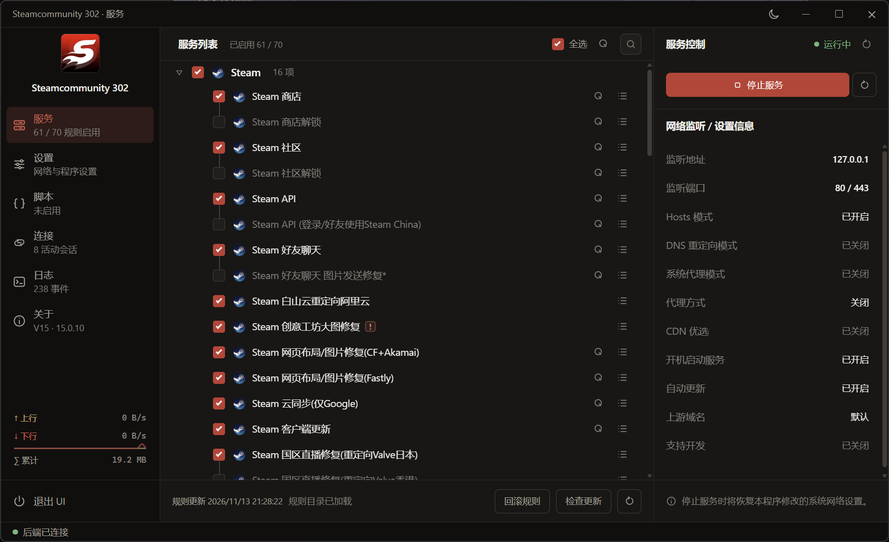

原文出处：

@link[Steamcommunity 302](https://www.dogfight360.com/blog/18682/)

Steamcommunity 302（简称S302），由羽翼城(Dogfight360)开发维护，是一款免费、跨平台的本地反代工具，主要用来解决国内环境下 Steam社区、创意工坊、个人资料页访问报错（118/105等）、加载缓慢、图片裂图等网络问题，同时也支持GitHub、Discord、EA等部分站点的网络优化，支持 Windows、macOS、Linux / SteamDeck 全平台运行。

## ✨ 核心功能

Steam系列网络修复

Steam商店、社区、个人主页、好友聊天图片反代修复；

创意工坊大图修复、网页布局图片修复；

Steam API模式切换，区分国区SteamChina与全球登录环境；

CDN自动优选，自动测速选择低延迟节点，改善502、加载慢问题。

多种工作模式

Hosts模式：修改系统hosts，全局生效；

DNS重定向模式（NetFilterSDK / WinDivert驱动），接管DNS请求，不改动hosts文件；

PAC代理模式，适合不想修改hosts的用户；

后台无界面服务运行，支持开机自启，托盘快速启停服务。

证书与网络管理

自签发根证书自动安装/导出/重置，解决HTTPS证书不安全报错；

端口占用检测、hosts自动备份、日志查看、流量可视化；

用户脚本(UserScript)支持，可扩展自定义规则（V15新增）。

跨平台适配

Windows：x86‑64 / ARM64；

macOS：Intel、Apple Silicon；

Linux：AppImage、deb、rpm包，原生适配SteamDeck掌机游戏模式；

支持无GUI纯命令行后端部署，服务器环境可用cli模式运行。

## 📋 V15版本主要更新亮点（Ver.15.0.10）

新增UserScript脚本扩展能力；

Linux提供deb/rpm正式安装包，适配DroidDeck；

增加SteamDeck开启SteamAPI的登录风险警告；

修复Ubuntu证书导入、macOS休眠唤醒卡顿、证书生成失败等大量BUG；

DNS重定向默认切换为NetFilterSDK驱动，支持Windows ARM架构；

完善完全卸载流程，避免残留hosts、证书、系统服务垃圾文件。

## ⚠️ 常见坑与注意事项

SteamDeck/Linux无限循环登录 开启Steam API选项会导致新版Steam客户端卡登录，直接关闭该选项；已经卡死可切终端，通过修改配置文件或禁用s302服务解决后重启设备。

Windows安全软件报PUA/误删文件 工具会修改hosts、安装根证书、注册系统驱动，Windows Defender容易判定为PUA。需要手动添加目录排除，或者在保护历史中将程序放行。不要解压放到Program Files目录，会触发R6025运行时错误，建议解压到D盘普通目录。

与其他网络工具冲突 和mihomo、火绒、Vanguard拳头反作弊共存时会有兼容问题：

拳头Vanguard报错不兼容：DNS驱动切换为WinDivert；

mihomo冲突：增加系统环境变量DISABLE_SYSTEM_HOSTS=1，重启软件。

浏览器证书报错

Firefox：需要手动导入steamcommunityCA.pem根证书到证书颁发机构；

Chrome新版本出现本地网络权限弹窗：关闭chrome://flags/#local-network-access-check开关。

卸载务必走完整流程 1）停止服务；2）重置根证书；3）重置后台服务；4）关闭开机启动；5）退出UI；最后删除对应系统目录残留，不能只删exe，否则会遗留hosts、证书、系统服务项。

## 📌 使用简单流程（Windows为例）

下载对应架构压缩包，解压到非系统保护目录；

如果是精简系统，先运行download‑webview2‑amd64.bat补齐WebView2依赖；

打开主程序，勾选需要的服务项，推荐至少勾选Steam社区、商店相关；

点击启动服务，等待状态变为运行中；

打开Steam客户端访问社区、创意工坊进行测试。

提示：修改hosts、安装系统证书需要管理员/root权限，Linux/SteamDeck需要提前设置root密码并安装依赖包。

## 📎 重要提醒

该工具仅做本地域名解析与反代优化，不属于翻墙代理工具；

请务必从作者原博客下载，不要使用第三方修改打包版本；

软件为免费个人项目，遇到问题优先查阅原博客的FAQ排错列表。

如果你需要，我可以继续为你写一份极简上手速查表，或者整理一份SteamDeck完整安装排错清单。
