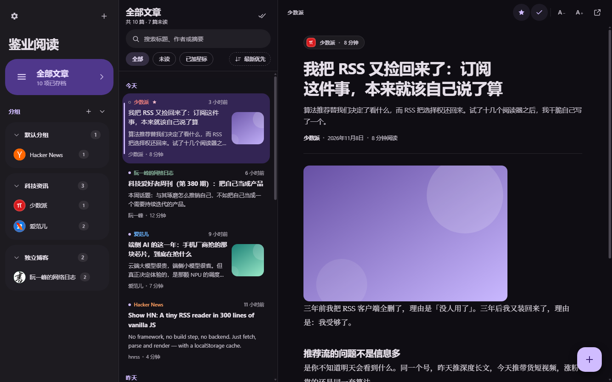
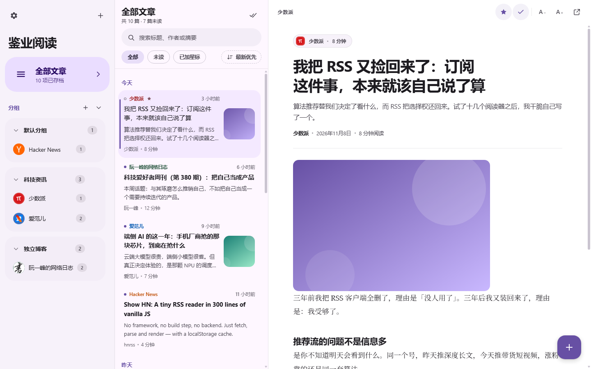
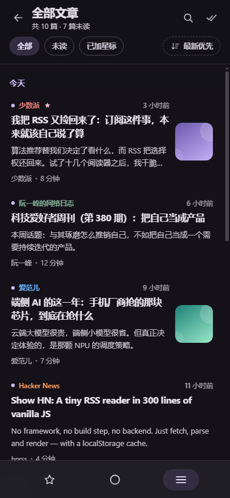

When it comes to subscribing, you should have the final say. But the reality is: if you want to read RSS, you must first install an app and then register an account. If you are unlucky, you have to pay a subscription fee - after paying the money, you will be given a "recommended reading" in the sidebar.

The tool itself makes the decision for you, and that's not right.

So I wrote one for myself: **Jianye Reading**, a pure front-end RSS reader. No framework, no build, no backend, no account, just open the browser and that's all. It has been deployed on my website and can be accessed by viewing the small station project page.

It looks like this when it opens, with a three-column layout: feed on the left, article list in the middle, and reading area on the right.

This article talks about how it is done, what is difficult, and where the car has turned over.

## 1. What does it look like?

There are not many functions, but each one is really useful when reading the article:

| what can you do | how to do it |
| --- | --- |
| Feed grouping | Create new groups, rename, drag feeds in and out, and there will be no clutter when there are too many sources. |
| Unread and starred | View only the unread, add stars to favorites, and click "3 days ago / 1 week ago / all" to mark read with one click |
| search | Title, author, abstract, filter while typing |
| OPML import and export | Move from other readers with one click and take all subscriptions with you at any time |
| Chinese and English bilingual interface | By default, it follows the system language and can be switched manually. |
| light and dark theme | Follow the system or fix it. The first screen will not flash white under dark systems. |
| Mobile phone adaptive | The desktop has three columns, and the mobile phone automatically changes to a single column drawer. |
| keyboard shortcuts | `/` Search, `J`/`K` Previous and next chapters, `M` Mark as read, `S` Add stars |

Light theme and what it looks like on mobile:

The entire project is three files: one `index.html`, one `app.js`, and one `styles.css`. Deploy to any static hosting and run.

## 2. Three key decisions

### 1. Zero dependencies, three files to take over the world

No npm install, no packaging, no framework runtime. The icons are handwritten SVG sprites inline in the page, and the pop-ups, drawers, toasts, and drop-down menus are all native DOM operations. The benefit is very direct: this project can still be opened and run ten years later, and it does not depend on any third-party packages.

### 2. No account is required, the data is only in your browser

Subscriptions, read, stars, topics, languages - all are stored in the browser's localStorage, managed by a key, and the key name has a version number (`jianread.state.v1`). No server knows what you subscribe to, and there is no "your free credit is about to run out."

The price is equally straightforward: clear browser data = clear browser. I will expand on this honestly in Section 5.

### 3. Chinese first, bilingual

The interface defaults to Chinese, with a complete set of Chinese-English dictionaries built-in. The language follows the system and can be switched manually. Even the barrier-free jump links such as "jump to article list" and the aria labels of each button are fully translated in both languages ​​- it is not that the accessibility functions are broken after the main interface is completed.

## 3. The most difficult thing is not parsing RSS, but cross-domain

If you directly `fetch` access someone else's RSS address in your browser, it will most likely be blocked by CORS - the origin site will not open cross-domain permission for your personal webpage. This is a wall that all pure front-end readers cannot get around. My solution is a three-level solution:

1. Try to crawl directly first (some sources actually have CORS enabled);
2. If it fails, switch to the public CORS proxy (allorigins, corsproxy) relay;
3. Each level has a timeout of 9 seconds. If it is completely hung up, it will clearly say "refresh failed", and the feed will still be retained. You can try again later.

Both RSS and Atom are parsed using the browser's native `DOMParser` and do not reference any XML library. When OPML imports dozens of sources at a time, the background crawl queue can have up to 4 concurrent entries, and will not wait for eternity in series.

> [!NOTE]
> The public proxy is the least "own" part of the entire solution: it limits traffic, occasionally convulses, and you are borrowing someone else's channel. Therefore, the failure is designed to be explicit - the interface directly tells you which source refresh failed and the reason for the failure, instead of silently giving you a "loading" message forever.

## 4. The pitfalls you have stepped on are worth recording.

**Under dark system, first flash one frame of white. ** Before the style sheet is loaded, the page is white by default, and users with dark colors will experience a flash every time they open it. The solution is to put a small synchronization script at the front of `<head>`: read the theme settings in localStorage before the style sheet takes effect, and directly set the background color and `data-theme`. Lesson: **The theme is a above-the-fold problem, not a rendering problem**.

**The content of the article belongs to others, and XSS cannot be gambled on. ** Text, titles, and abstracts all come from external feeds—that is, untrusted input. Titles and abstracts must be passed through escape functions before entering the template; the text with HTML is first disinfected in a controlled DOM container, scripts and dangerous attributes are removed, and then rendered into the reading area. Subscribers are the most overlooked attack surface: you let them pull HTML from strangers every day.

**localStorage cannot be silenced when it is full. ** When the storage is full, `QuotaExceededError` will be thrown. The default behavior is to fly away abnormally and the user thinks the save is successful. Now this error is caught every time I write, and a toast of "Insufficient local storage space" pops up. It is better to make noise than to lose.

**There is no link to the source, so you can only identify the person by the title. ** The key to deduplicating articles is "link. If there is no link, the title will be returned" - some sources do not output permalink, and two articles with the same title will be misjudged as the same article and discarded. This is a conscious compromise: the probability of accidental damage is much smaller than the probability of endless accumulation of articles when there are no keys to remove duplicates, but you must be aware of it.

## 5. What it can’t do, make it clear

- **No cloud sync. ** If you don’t have an account, if you change browsers or devices, the read and star marks will not be lost. The feed can be taken away via OPML export, but the reading progress cannot. This is a direct cost of "data not leaving the browser", and I'm not going to pretend it doesn't exist.
- **Relies on public proxies. ** Some sources that are strict in anti-climbing may not be able to catch all three channels. Such sources can basically only be given up.
- **localStorage has a capacity limit. ** Generally about 5 MB. If there are too many feeds and the text is too long, it will not be saved - you will be prompted, but the prompt cannot replace the capacity.
- **The text is subject to source output. ** If the source provides an abstract, the abstract will be displayed, and if the source provides the full text, the full text will be displayed. This is not the fault of the reader, but a convention.

## 6. Write at the end

This little thing does not have high technical content, but it solves a real awkwardness: **Subscription is originally a matter that you have the final say, and you should not go through a registration and a subscription fee first. **

Now it is placed in my own browser tab. I open it every morning and take a look. I press the `J` key to scroll down and the `S` key to save the good articles. If you also want to move RSS into your browser, just use it directly.

No registration required, just open it and use it, and the data will not leave your browser.
