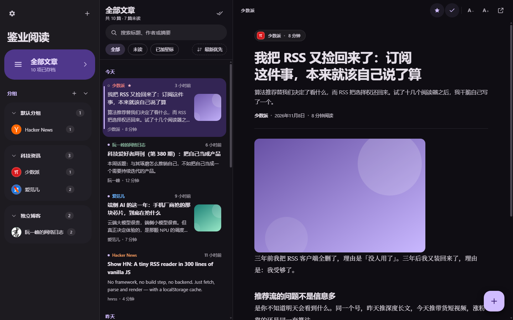
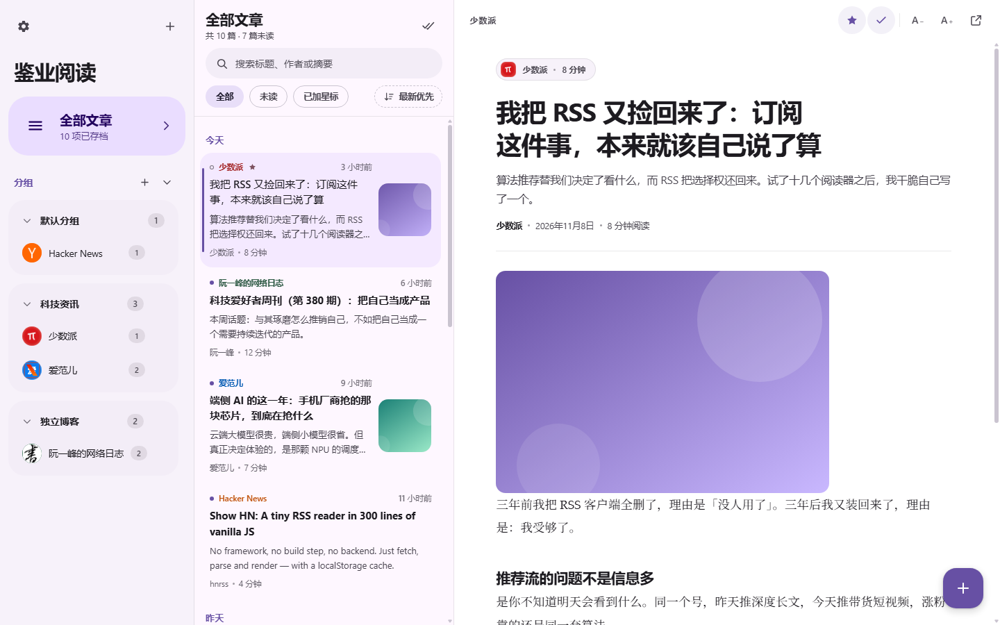
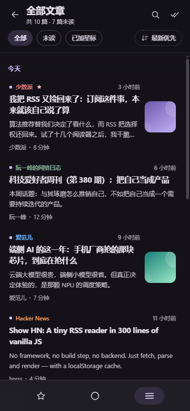

订阅这件事，本来就该自己说了算。可现实是：想看 RSS，先得装个 App，然后注册账号，运气不好还要交订阅费——交完钱，边栏里还给你塞一个「推荐阅读」。

工具本身替你做了决定，这不对。

所以我给自己写了一个：**鉴业阅读**，一个纯前端的 RSS 阅读器。没有框架、没有构建、没有后端、没有账号，打开浏览器就是全部。它已经部署在我的网站上，查看小站项目页面即可访问。

打开就是这个样子，三栏布局：左边订阅源，中间文章列表，右边阅读区。

这篇文章聊聊它是怎么做的、难在哪、以及哪里翻过车。

## 一、它长什么样

功能不多，但每一件都是读文章真正用得上的：

| 你能做什么 | 怎么做到的 |
| --- | --- |
| 订阅源分组 | 新建分组、重命名、把订阅源拖进拖出，源多了也不乱 |
| 未读与星标 | 只看未读、加星收藏，还能按「3 天前 / 1 周前 / 全部」一键标已读 |
| 搜索 | 标题、作者、摘要，边打字边过滤 |
| OPML 导入导出 | 从别的阅读器一键搬家，也随时可以带走全部订阅 |
| 中英双语界面 | 默认跟随系统语言，可手动切换 |
| 明暗主题 | 跟随系统或固定，深色系统下首屏不闪白 |
| 手机自适应 | 桌面三栏，手机自动变单栏抽屉 |
| 键盘快捷键 | `/` 搜索、`J`/`K` 上下篇、`M` 标已读、`S` 加星 |

浅色主题和手机上的样子：

整个项目就是三个文件：一个 `index.html`，一个 `app.js`，一个 `styles.css`。部署到任何静态托管上就能跑。

## 二、三个关键决定

### 1. 零依赖，三个文件走天下

没有 npm install，没有打包，没有框架运行时。图标是手写的 SVG sprite 内联在页面里，弹层、抽屉、toast、下拉菜单全是原生 DOM 操作。好处很直接：这个项目十年后打开还能跑，不依赖任何第三方包还活着没有。

### 2. 不建账号，数据只在你浏览器里

订阅、已读、星标、主题、语言——全部存在浏览器的 localStorage 里，一个键管到底，键名带版本号（`jianread.state.v1`）。没有服务器知道你订阅了什么，也没有「您的免费额度即将用尽」。

代价同样直白：清浏览器数据 = 清空阅读器。我在第五节会诚实展开这一点。

### 3. 中文优先，双语兜底

界面默认中文，内置一套完整的中英字典，语言跟随系统、可手动切换。连「跳到文章列表」这种无障碍跳转链接、每个按钮的 aria 标签都是两套语言都翻全的——不是主界面翻完了辅助功能就摆烂。

## 三、最难的不是解析 RSS，是跨域

浏览器里直接 `fetch` 别人家的 RSS 地址，大概率会被 CORS 拦下来——源站不会为你的个人网页开跨域许可。这是所有纯前端阅读器绕不开的一堵墙，我的解法是三级兜底：

1. 先试直接抓取（部分源真的开了 CORS）；
2. 失败就换公共 CORS 代理（allorigins、corsproxy）接力；
3. 每一级 9 秒超时，全挂就明说「刷新失败」，订阅源仍然保留，稍后可重试。

RSS 和 Atom 都用浏览器原生的 `DOMParser` 解析，不引任何 XML 库。OPML 一次导入几十个源时，后台抓取队列最多 4 条并发，不会串行等到天荒地老。

> [!NOTE]
> 公共代理是整个方案里最不「自己的」一环：它限流、偶尔抽风，而且你等于借了别人的通道。所以失败被设计成显式的——界面上直接告诉你哪个源刷新失败、失败原因是什么，而不是默默给你一个永远「加载中」。

## 四、踩过的坑，值得记下来

**深色系统下先闪一帧白。** 样式表加载完之前，页面默认是白的，深色用户每次打开都挨一下闪。解法是在 `<head>` 最前面放一段同步小脚本：样式表生效前就读完 localStorage 里的主题设置，直接把背景色和 `data-theme` 定死。教训：**主题是首屏问题，不是渲染问题**。

**文章内容是别人的，XSS 不能赌。** 正文、标题、摘要全部来自外部订阅源——也就是不可信输入。标题、摘要一律过转义函数再进模板；带 HTML 的正文先在受控的 DOM 容器里消毒，摘掉脚本和危险属性，再渲染进阅读区。订阅器是最容易被忽视的攻击面：**你每天让它拉取陌生人的 HTML**。

**localStorage 满了不能静默。** 存储写满会抛 `QuotaExceededError`，默认行为是异常飞走、用户以为保存成功了。现在每次写入都捕获这个错误，弹一条「本地存储空间不足」的 toast。宁可吵，不可丢。

**没有 link 的源，只能靠标题认人。** 文章去重的键是「链接，没有链接就退回标题」——有些源不输出 permalink，两篇标题相同的文章会被误判成同一篇丢掉。这是个有意识的折中：误伤的概率，远小于没有键可去重时文章无限堆积的概率，但心里要有数。

## 五、它不能做什么，说清楚

- **没有云同步。** 没有账号，换浏览器或换设备，已读和星标不会跟人走。订阅源可以靠 OPML 导出带走，但阅读进度不行。这是「数据不出浏览器」的直接代价，我不打算假装它不存在。
- **依赖公共代理。** 个别反爬严格的源可能三个通道都抓不到，这类源基本只能放弃。
- **localStorage 有容量上限。** 一般 5 MB 左右，订阅源太多、正文太长会存不下——会提示你，但提示替代不了容量。
- **正文以源输出为准。** 源给摘要就显示摘要，给全文才有全文。这不是阅读器的锅，是约定俗成。

## 六、写在最后

这个小东西没有多高的技术含量，但它解决了一个真实的别扭：**订阅本来是自己说了算的事，不该先经过一道注册和一笔订阅费。**

现在它就摆在我自己的浏览器标签页里，每天早上打开看一眼，`J` 键往下翻，`S` 键把好文章留下来。如果你也想把 RSS 搬进浏览器，直接用就好。

无需注册，打开即用，数据不出你的浏览器。
