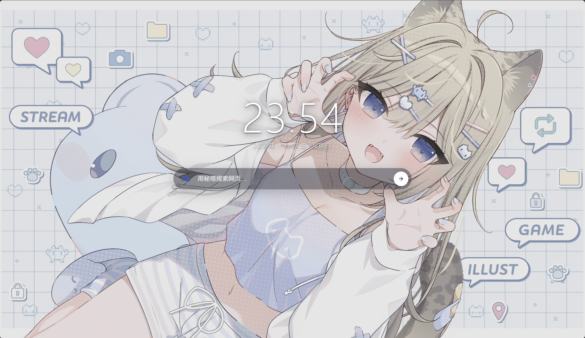

Write in front:
The core idea of ​​this version of the update is simple—reduce cumbersome operations and make every time you open a new tab smooth, beautiful, and efficient. There are no complicated deep changes, all are optimization points that can be most perceived in daily use.

## 🖼️ Picture/video background, homepage wallpaper free
Many friends have reported before that they hope that the new tab page will no longer be limited to static solid colors or built-in wallpapers. This time we have arranged: **Support pictures and videos as homepage background**.
Whether it's local scenery, screenshots, or your favorite short videos, you can set them directly. The dynamic video background is full of atmosphere, and the static pictures are clean and attractive, creating your own browser start page.

## ⚡ Direct access to the website, identify the URL and open it with one click
The input box has been upgraded with intelligent recognition. When you enter the URL directly, there is no need for additional confirmation or jumping to the search page first. If the recognition is successful, the corresponding website will be opened directly.
Eliminate the steps of copying and pasting, and making secondary jumps, and access frequently used sites faster.

## 🔁 Tab key temporarily switches search engines
Don’t want to stick to just one engine for search? Now press **Tab** to temporarily switch search engines.
You can temporarily look up information or search from different sources without having to go to the settings page to change the default engine. You can flexibly switch between searches in a single time and automatically restore the default engine after use.

## 🖱️ Right-click one-stop adjustment, say goodbye to the buried settings panel
Appearance, display language, background, and wallpaper switching are all integrated into the right-click menu.
There is no need to click on the multi-layer settings page. You can quickly switch adjustments by right-clicking on the blank space of the tab page. It is lightweight and adjustable. If you like to change styles repeatedly, this function will be very comfortable.

## 🤖 Added new secret tower AI search option
This update adds **Secret Tower AI Search**.
As an AI search without advertisements and with reference sources, it is suitable for scenarios that require structured answers, information review, and research. Now it can be selected directly in the new tab page, providing a reliable choice for searching questions and finding information.

## Summary
This update focuses on the experience level: good-looking (customized picture/video background), faster (direct URL), flexible (Tab cutting engine), simple (right-click quick configuration), and also accesses Secret Tower AI search to expand search capabilities.
In the future, we will continue to collect your feedback and continue to polish this new tab page.
