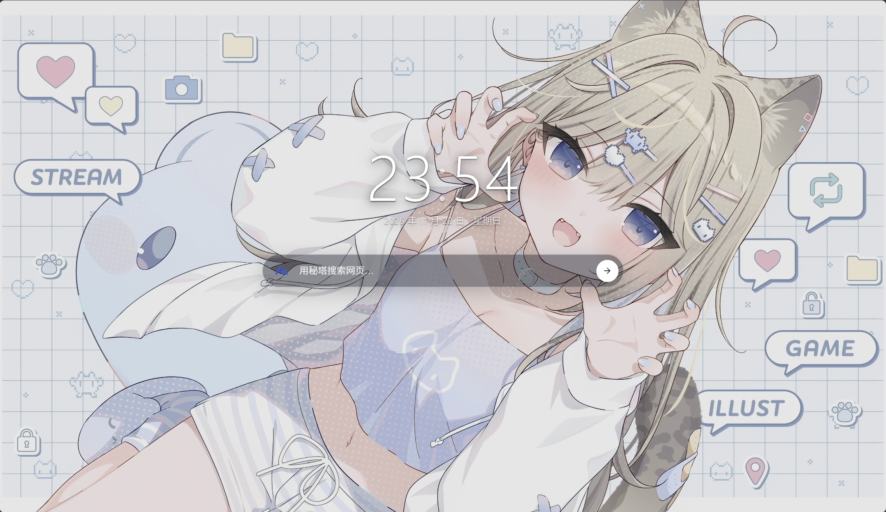

写在前面：
这一版的更新，核心想法很简单——减少繁琐操作，让每次打开新标签都顺手、好看、高效。没有复杂的深层改动，全部是日常使用里最能感知到的优化点。

## 🖼️ 图片/视频背景，主页壁纸自由
之前不少朋友反馈，希望新标签页不再局限于静态纯色或者内置壁纸。这次安排上了：**支持图片、视频作为主页背景**。
不管是本地风景图、截图，还是喜欢的短视频，都可以直接设置。动态视频背景氛围感拉满，静态图片干净耐看，打造属于自己的浏览器起始页。

## ⚡ 网站直达，识别网址一键打开
输入框升级了智能识别。当你直接输入网址，不用额外确认、不用先跳转搜索页面，识别成功就会直接打开对应网站。
省去复制粘贴、二次跳转的步骤，访问常用站点更快一步。

## 🔁 Tab键临时切换搜索引擎
搜索不想固定只用一个引擎？现在按下 **Tab**，就可以临时切换搜索引擎。
临时查资料、换不同源检索，不用跑去设置页修改默认引擎，单次搜索灵活切换，用完自动恢复默认。

## 🖱️ 右键一站式调节，告别深埋的设置面板
外观、显示语言、背景、壁纸切换，全都整合进右键菜单。
不需要点开多层设置页面，在标签页空白处右键一点，就能快速切换调整。轻量化、随手可调，喜欢反复换样式的话，这个功能会很舒服。

## 🤖 新增秘塔AI搜索选项
本次更新加入 **秘塔AI搜索**。
作为无广告、带引用来源的AI搜索，适合需要结构化答案、查阅资料、做调研的场景。现在在新标签页里可以直接选用，检索问题、查找信息多了一个靠谱选择。

## 小结
这次更新偏向体验层面：好看（自定义图/视频背景）、更快（网址直达）、灵活（Tab切引擎）、简单（右键快捷配置），同时接入秘塔AI搜索扩充搜索能力。
后续还会继续收集大家的使用反馈，继续打磨这个新标签页。