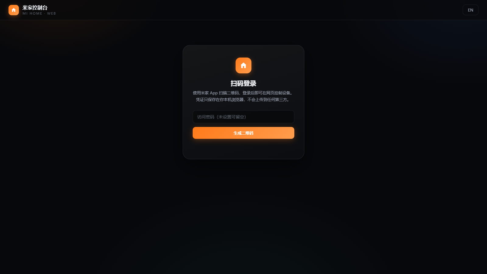

There are more than a dozen Mijia devices at home. The most annoying thing is not that they are not easy to use, but that every time I want to turn on the air conditioner, I have to take out my phone, unlock it, find the app, and wait for it to load.

You are obviously sitting in front of the computer, with the keyboard and mouse at your fingertips. Why do you have to go through your mobile phone to turn on the air conditioner?

So I wrote myself a **Mijia web console**: open the browser, scan the code, and all the devices at home will be spread out on one web page, and you can move them with just one click. It has been deployed on my website and can be used by clicking the link below:

**👉[Open Mijia web console](https://jianye.pages.dev/mijia-pages)**

This is what it will look like when you open it. Scan the QR code on the Mijia App to log in:

This article talks about how it is done, what is difficult, and where the car has turned over.

## 1. What does it look like?

After logging in, there is a list of devices, with one card for each device:

| what can you do | how to do it |
| --- | --- |
| Scan the QR code to log in to Xiaomi account | The web page generates a QR code, and you can scan it on the Mijia App to log in without entering a password. |
| Automatically generate control controls | Switches, gear buttons, and sliders automatically appear according to device specifications, without having to adapt them one by one. |
| View device status | Read-only attributes such as temperature, humidity, switch status, etc. are displayed directly on the card |
| Chinese and English bilingual interface | Switch with one click in the upper right corner, and the selection will be remembered. |
| Camera screen (optional) | Bridge the local screen through go2rtc, see Section 4 for details |
| Manual debugging | Built-in debugging panel, you can directly send custom requests to Xiaomi API |

The entire project does not have any database, no user system, and no resident server process - deploying to Cloudflare Pages is just two files: one `index.html` and one `_worker.js`.

## 2. Three key decisions

### 1. Purely static, nothing stored

There are only two parties in the architecture: your browser, and Xiaomi's cloud API. The Cloudflare Worker in the middle only does one thing - **sign the request**.

> [!NOTE]
> Why do you need Worker to sign on your behalf? Every request of Xiaomi API must use the account key to calculate the signature. Putting this link in a pure front-end will run into the problem of CORS and key exposure. After receiving the browser's request, the Worker adds a signature and forwards it to Xiaomi, and then brings the result back as is - it does not store, cache, or parse any of your data.

The credentials (serviceToken, ssecurity, etc.) obtained after successful login are only stored in the localStorage of your own browser, and will be cleared when you log out. The site itself also supports setting an access password to prevent the link from being used by others.

### 2. Specification driven, no device adaptation

There are hundreds of Mijia device models, and it is impossible to write controls for each one. Fortunately, Xiaomi has a public MIoT Spec (Model of Things Specification): each device has a specification description, which clearly states what services (siid) it has, what attributes (piid) it has, and whether the attributes are Boolean, enumeration, or numerical range.

So what the console does is: **Pull device specifications → Parse out all writable properties → Generate controls by type**.

- boolean property → a switch
- Enumerated attributes → a row of gear buttons (such as air conditioning mode: cooling / heating / dehumidification / air supply)
- Range attribute → slider or stepper (e.g. temperature 16–30°C)
- Read-only attribute → directly displayed in status area

When you buy a new device, refresh the page and it will appear by itself, with zero adaptation.

### 3. Chinese first

Most of the field descriptions in the specifications are in English, or simply Pinyin abbreviations. I counted **581 official specifications**, extracted more than 2,300 attribute names, more than 500 service names, and more than 1,400 option values, compiled them into an offline dictionary and packaged them into the page - so every button and every status you see is in authentic Chinese, and **does not rely on any online translation**.

## 3. The most difficult thing is not issuing commands, but "status rebound"

This is where I spent the most time on the entire project.

You click on the air conditioner, and the interface immediately displays "Sent", and then the switch in the status bar jumps back to "Off" - obviously the air conditioner is on.

The reason is simple: device status updates are asynchronous. The command is issued successfully, but it may take a few seconds before the cloud status is actually updated. If you read it back immediately after sending it, the old value will still be read back. Once overwritten, the interface will "rebound".

The final solution is **optimistic update + multiple rounds of confirmation**:

1. Click the switch, and the interface will display the target status **immediately** (trust the user first);
2. At the same time, read back the true status once at 1.5 seconds, 3 seconds, 5 seconds, and 7.5 seconds;
3. Any readback confirmation is successful and the display is locked;
4. If there is no confirmation after 9.5 seconds, it will clearly prompt "The command has been sent, but the device has not yet confirmed it" instead of silently changing it back;
5. Any readback will not overwrite the state you just set before confirming - old values are not eligible to win.

The difference in experience is obvious: once you click, you click, and we will no longer play "Schrödinger's switch" with you.

## 4. Camera: an honest exception

Among all the devices, the camera is the only one where the cloud solution is not feasible.

The reason is not complicated: Mijia camera images use **P2P encrypted streaming** and do not go through the cloud attribute interface at all. The real-time picture you see in the Mijia App is an encrypted tunnel built directly between the phone and the camera. The official integration for Home Assistant also clearly states: video streaming is not supported.

So I don’t have a hard dent. The camera card in the console uses a local solution: run [go2rtc](https://github.com/AlexxIT/go2rtc) on a device that is always on at home (it natively supports P2P streaming of Xiaomi cameras), and the console uses an iframe to embed its playback page.

- Want to use: Click the gear on the card, fill in the go2rtc address and stream name, and complete the configuration in three steps;
- Don't want to bother: the card will clearly say "Video source not configured", don't pretend to understand.

> [!NOTE]
> go2rtc needs to be in the same LAN as the camera, and the streaming key of the Xiaomi camera may change every time it is connected to the Internet and needs to be updated regularly. This is currently the most feasible open source solution - it's not that I'm lazy, it's that there is really no better way.

## 5. The pitfalls you have stepped on are worth recording.

**The switch does not move. ** The earliest version of the switch is a `div` covered with a zero-size `input`. It exists visually but does not exist on the event level. Change it to `label` and wrap and input to cover the entire hot zone to solve the problem. Lesson: **CSS is visible ≠ can be clicked**.

**The control object does not match the number. ** There is a "command sending" lock on the front end to prevent the status from being overwritten by old values. But when I registered the control, what I stuffed into the array was not the control itself, but a new object with the same content - the copy was changed, but the original remained intact. This kind of bug does not report an error in the compiler or in the test. It only appears when the real machine jumps back and forth from the previous state.

**Caching kills people. ** When the offline dictionary was cached for the first time, the key names did not change versions, the old structure kept hitting, and the interface could never display Chinese. Later, I learned it well: the cache key carries a version number, and the a priori structure is read out. If it is not correct, the whole thing is thrown away and retrieved again.

**Translation cannot rely on fields alone. ** `description` in the specification is sometimes in English, sometimes the same as the comments, and sometimes missing altogether. The final strategy is five levels of coverage: Chinese annotation → type identification dictionary → core vocabulary → general vocabulary → original text coverage. I would rather spend an extra night counting 581 specifications than have a "Mode 2" appear on the interface.

## 6. Security, make it clear

- The credentials are only in your browser and will be cleared when you log out, leaving no copy on the server;
- All requests to Xiaomi API are forwarded through the signed proxy, and the proxy itself is stateless;
- Optional access code to keep out uninvited guests;
- It is not an official client, and the interface may become invalid as Xiaomi adjusts it - just be aware of it when using it.

**It is recommended not to log in on a public computer**, just like any web page with login status.

## 7. Write at the end

This little thing does not have a high technical content, but it solves a real awkwardness: the person is in front of the computer, but the control is in the mobile phone. **

Now after writing an article, you can turn on the air conditioner or turn off the lights before going to bed, all with a click on the browser. If you also want to bring Mijia into the browser, just use it directly:

**👉[Open Mijia web console](https://jianye.pages.dev/mijia-pages)**

Scan the QR code to log in, no registration is required, and the credentials do not exit your browser.
