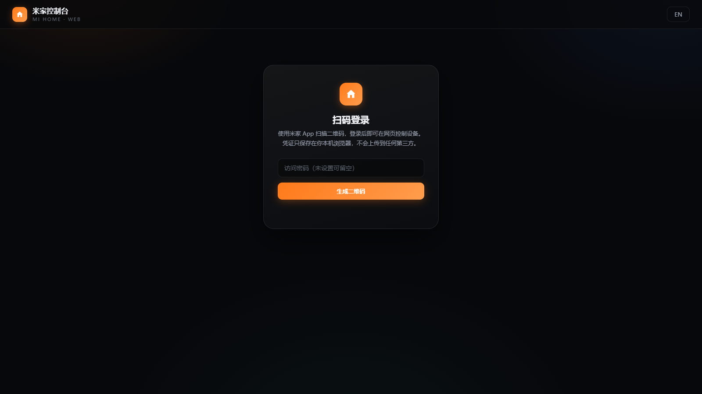

家里十几台米家设备，最烦的不是它们不好用，而是每次想开个空调都得掏手机、解锁、找 App、等它加载完。

人明明就坐在电脑前，键盘鼠标就在手边，凭什么开个空调还要经过手机？

所以我给自己写了一个**米家网页控制台**：打开浏览器、扫一次码，家里所有设备就摊在一个网页里，点一下就动。它已经部署在我的网站上，点下面这个链接就能用：

**👉 [打开米家网页控制台](https://jianye.pages.dev/mijia-pages)**

打开就是这个样子，米家 App 扫一下二维码即可登录：

这篇文章聊聊它是怎么做的、难在哪、以及哪里翻过车。

## 一、它长什么样

登录之后就是一个设备列表，每台设备一张卡片：

| 你能做什么 | 怎么做到的 |
| --- | --- |
| 扫码登录小米账号 | 网页生成二维码，米家 App 扫一下即登录，不用输密码 |
| 自动生成控制控件 | 按设备规格自动出现开关、档位按钮、滑条，不用逐台适配 |
| 查看设备状态 | 温度、湿度、开关状态等只读属性直接显示在卡片上 |
| 中英双语界面 | 右上角一键切换，选择会记住 |
| 摄像头画面（可选） | 通过 go2rtc 桥接本地画面，详见第四节 |
| 手动调试 | 内置调试面板，可以直接对小米 API 发自定义请求 |

整个项目没有任何数据库、没有用户系统、没有常驻服务器进程——部署到 Cloudflare Pages 就是两个文件：一个 `index.html`，一个 `_worker.js`。

## 二、三个关键决定

### 1. 纯静态，不存任何东西

架构上只有两方：你的浏览器，和小米的云 API。中间的 Cloudflare Worker 只做一件事——**代签请求**。

> [!NOTE]
> 为什么需要 Worker 代签？小米 API 的每个请求都要用账号密钥计算签名，这个环节放在纯前端会撞上 CORS 和密钥暴露的问题。Worker 收到浏览器的请求后补上签名转发给小米，再把结果原样带回——它不存储、不缓存、不解析你的任何数据。

登录成功后拿到的凭据（serviceToken、ssecurity 这些）**只存在你自己浏览器的 localStorage 里**，退出登录即清除。站点本身还支持设置一个访问密码，防止链接被别人扫到乱用。

### 2. 规格驱动，不做设备适配

米家的设备型号几百种，一台一台写控件是不可能的。好在小米有一套公开的 MIoT Spec（物模规范）：每台设备都有一份规格描述，写清楚了它有哪些服务（siid）、哪些属性（piid）、属性是布尔、枚举还是数值范围。

所以控制台的做法是：**拉取设备规格 → 解析出所有可写属性 → 按类型生成控件**。

- 布尔属性 → 一个开关
- 枚举属性 → 一排档位按钮（比如空调模式：制冷 / 制热 / 除湿 / 送风）
- 范围属性 → 滑条或步进器（比如温度 16–30℃）
- 只读属性 → 状态区直接展示

新买一台设备，刷新页面它就自己出现了，零适配。

### 3. 中文优先

规格里的字段描述大多是英文，或者干脆是拼音式的缩写。我统计了 **581 份官方规格**，提取出 2300 多条属性名、500 多条服务名、1400 多条选项值，整理成一份离线词典打包进页面——所以你看到的每个按钮、每个状态都是正经中文，而且**不依赖任何在线翻译**。

## 三、最难的不是发指令，是「状态回弹」

这是整个项目里我磨得最久的地方。

你点开空调，界面立刻显示「已发送」，然后状态栏的开关**又跳回「关」**——明明空调已经开了。

原因很简单：设备状态更新是异步的。指令下发成功了，但云端的状态可能要几秒后才真正更新。如果下发完立刻回读，读回来的还是旧值，一覆盖，界面就「回弹」了。

最后的方案是**乐观更新 + 多轮确认**：

1. 点下开关，界面**立刻**显示目标状态（先相信用户）；
2. 同时在 1.5 秒、3 秒、5 秒、7.5 秒各回读一次真实状态；
3. 任何一次回读确认成功，锁定显示；
4. 如果 9.5 秒后还没确认，明确提示「指令已发送，但设备暂未确认」，而不是默默改回去；
5. 确认之前，任何回读都不会覆盖你刚设置的状态——旧值没有资格赢。

体验上的差别很明显：点了就是点了，不再跟你玩「薛定谔的开关」。

## 四、摄像头：一个诚实的例外

所有设备里，摄像头是唯一一个「云端方案走不通」的。

原因说出来不复杂：米家摄像头的画面走的是 **P2P 加密流**，根本不经过云端属性接口。你在米家 App 里看到的实时画面，是手机和摄像头之间直接建的加密隧道。官方给 Home Assistant 的集成也明确写了：不支持视频流。

所以我没有硬凹。控制台里的摄像头卡片走本地方案：在家里一台常开的设备上跑 [go2rtc](https://github.com/AlexxIT/go2rtc)（它原生支持小米摄像头的 P2P 拉流），控制台用 iframe 嵌入它的播放页。

- 想用：在卡片上点齿轮，填入 go2rtc 地址和流名，三步配完；
- 不想折腾：卡片会明说「未配置视频源」，不装懂。

> [!NOTE]
> go2rtc 需要和摄像头在同一局域网，而且小米摄像头的取流密钥每次联网可能变化，需要定期更新。这是目前最可行的开源方案——不是懒，是真没有更好的路。

## 五、踩过的坑，值得记下来

**开关点不动。** 最早版本的开关是个 `div` 套了个零尺寸的 `input`，视觉上存在，事件层上不存在。改成 `label` 包裹、input 铺满整个热区才解决。教训：**CSS 看得见 ≠ 能点**。

**控制对象对不上号。** 前端有个「指令发送中」的锁，防止状态被旧值覆盖。但我注册控件时塞进数组的不是控件本身，而是一个内容相同的新对象——改了副本，原件毫发无损。这种 bug 编译器不报错、测试不报错，只有真机上一个状态来回跳的时候才会现形。

**缓存害人。** 离线词典第一次做成缓存时，键名没换版本，旧结构一直命中，界面永远出不来中文。后来学乖了：缓存键带版本号，读出来先验结构，不对就整个扔掉重取。

**翻译不能只靠字段。** 规格里的 `description` 有时是英文、有时和注释一样、有时干脆缺失。最终策略是五级兜底：中文注释 → 类型标识查词典 → 核心词表 → 通用词表 → 原文兜底。宁可多花一晚上统计 581 份规格，也不想界面上出现一个「Mode 2」。

## 六、安全性，说清楚

- 凭据只在你浏览器里，退出登录即清除，服务器不留副本；
- 对小米 API 的所有请求都经由签名代理转发，代理本身无状态；
- 可选的访问密码挡住不速之客；
- 它不是官方客户端，接口随小米调整可能失效——用的时候心里有数就好。

**建议别在公共电脑上登录**，和对待任何带登录态的网页一样。

## 七、写在最后

这个小东西没有多高的技术含量，但它解决了一个真实的别扭：**人在电脑前，控制权却在手机里。**

现在写完文章顺手开个空调、睡前关个灯，都是浏览器里点一下的事。如果你也想把米家搬进浏览器，直接用就好：

**👉 [打开米家网页控制台](https://jianye.pages.dev/mijia-pages)**

扫码登录，无需注册，凭据不出你的浏览器。
