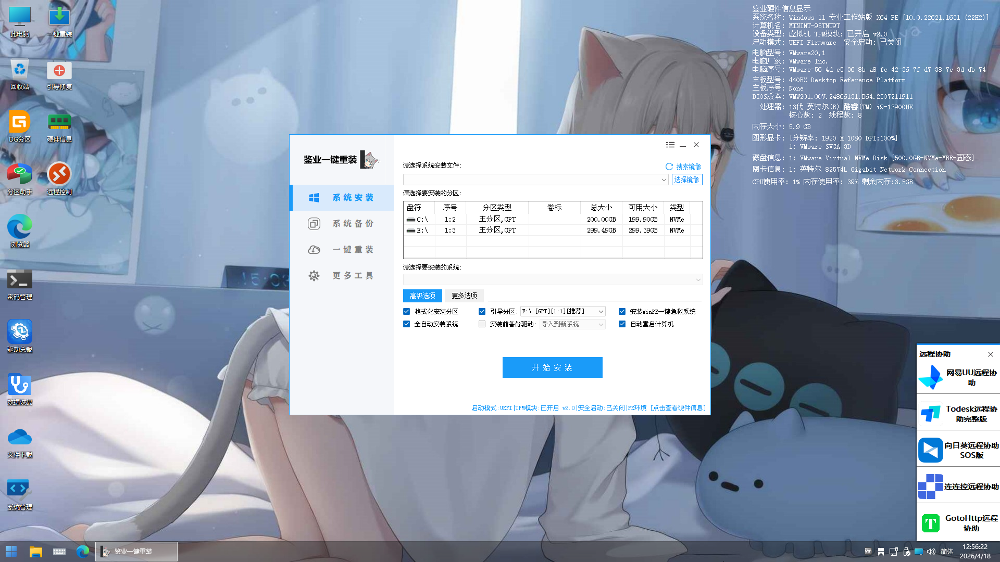
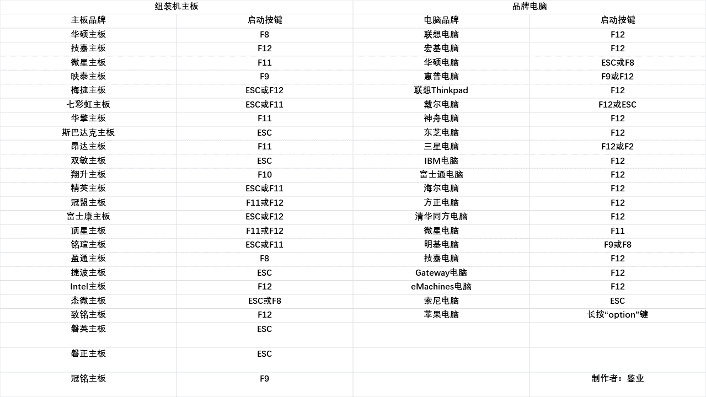
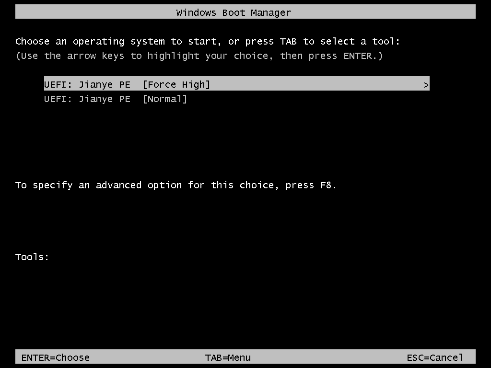

> Project homepage: [https://jianye.pages.dev/pe/](https://jianye.pages.dev/pe/)

The computer has a blue screen and cannot be turned on? System needs to be reinstalled? Important data needs to be rescued? When encountering these problems, a useful PE maintenance system is your life-saving toolbox. Today I would like to introduce to you the **Jianye PE (Jianye PE)** developed by me, a free, pure, beautiful interface and fully functional third-party Windows PE pre-installation environment.

## What is Jianye PE?
Jianye PE is built based on Microsoft Windows PE pre-installation environment. It does not need to be installed on the computer hard disk. It only needs to be written to the USB flash drive and can run independently after booting from the USB flash drive.
It is separated from the damaged Windows system and is not affected by the original system virus or system damage. It is specially used for maintenance work such as system reinstallation, troubleshooting, data rescue, hardware testing, etc. It allows you to carry the U disk with you and carry out maintenance anywhere.

The design concept adheres to three points: **simplicity, practicality and convenience**.
- **Simple**: Polish the UI interface and say goodbye to the rough visual experience of old PE;
- **Practical**: Integrate a full set of machine maintenance tools, taking care of both novices and operation and maintenance personnel;
- **Convenience**: U disk carrier, easy to operate, even novices can get started quickly.

> Commitment: **No ads, no bundling, no rogue programs, completely free to use**. Most virus reports from anti-virus software are false positives from PE tools. For study and research use only, please support Microsoft genuine systems.

## 🛠️ Core functions at a glance
### ✅System reinstallation and backup and restoration
The built-in graphical system installer can directly mount the ISO image to install Windows with one click, and novices can also complete the reinstallation.
Supports full disk/partition backup and one-click restore. Make a backup before the system crashes, and restore it directly if there is a problem without having to reinstall the system repeatedly.

### ✅Data Rescue
When the original system cannot be accessed, you can directly read the hard disk files and rescue important data. Supports accidentally deleted file recovery and partition repair, giving priority to rescuing your data to avoid data loss.

### ✅Disk partition management
Built-in disk tools such as DiskGenius support partition adjustment, formatting, boot repair, MBR/GPT partition format conversion, and handle various hard disk partition problems.

### ✅Hardware detection
Integrate tools such as CPU‑Z and AIDA64 to quickly check the health status of the CPU, memory, and hard disk, and troubleshoot hardware faults.

### ✅Full network support
With the built-in network card driver, you can directly connect to the Internet after entering the PE. You can also use the browser, download the driver, and remotely ask for help. During maintenance, there is no need to "operate blindly without disconnecting the network".

### ✅More practical tools
- Clear Windows startup password, no need to reinstall the system if you forget your login password;
- Virus scanning environment, registry modification, forced file deletion and other high-privilege operations;
- Driver installation module 3.0, handles hardware driver issues in the PE environment;
- Supports UEFI and traditional Legacy dual-boot modes, compatible with both old and new computers.

## 📝 Quick Start: Make Jianye PE boot disk in three steps
### Preparation conditions
- U disk, **8G or above is recommended, 16G is preferred**; ⚠️The U disk will be cleared during production, please back up all files on the U disk in advance.
- Obtain the latest image file of Jianye PE (fill in the form on the official website to download)

1. **Download image**
Visit the project homepage, fill out the form to obtain the latest version of the ISO image, and verify the file integrity.

2. **Write to U disk**
You can use tools such as Rufus and Ventoy to write the image to a USB flash drive. Ventoy users can directly throw the ISO into the Ventoy U disk and use it without repeated formatting.

3. **Boot the USB disk into PE**
Insert the USB flash drive into the faulty computer, turn it on and quickly press the startup shortcut key of the motherboard/laptop (F8/F11/F12/ESC, the keys are different for different brands of equipment), bring up the boot menu, and select the USB flash drive to boot.

> If you don’t remember the keys, you can press F10, F11, F12, and ESC at the same time when turning on the computer.

> There are `Force High` high performance mode and `Normal` normal mode in the startup menu. You can choose to enter the PE desktop according to the computer configuration.

Once you enter the desktop, you can use all tools to reinstall the system, back up data, and troubleshoot the computer.

## 🧩 Open branch for modification
Jianye PE allows everyone to freely modify and develop derivatives without the need for project consent.
However, derivative branches must comply with: maintaining no hijacking, no advertising, no fees, and complying with domestic laws.
The modified work is regarded as a modified branch of Jianye PE, and excellent derivative projects such as Xiaogang PE.
If a branch is added to advertising bundles, this project will not recognize the relationship between the derivative work and this project.

## 📚 Get resources and documents
- Project official website: [https://jianye.pages.dev/pe/](https://jianye.pages.dev/pe/)
- FAQ, update log, known issues, and feedback forms are all in Feishu documents.
- If you encounter problems, you can consult the instruction manual, or submit a feedback form to submit bugs and suggestions.

## ⚠️Disclaimer
All resources in this project are for learning and research only. Please complete the test within 24 hours after obtaining them. The copyright belongs to the original Microsoft author. For long-term use, please purchase a genuine Windows license.

---

### Write at the end
There are many PE tools on the market, many of which are bundled with advertisements, but Jianye PE hopes to provide a clean, good-looking, and fully functional maintenance environment. Whether it is an ordinary user reinstalling the system to rescue data, or an operation and maintenance personnel carrying it around to maintain the computer, they can put it into a USB flash drive and use it as a portable toolbox.

If you have tried many PEs and are not satisfied, welcome to experience Jianye PE.
