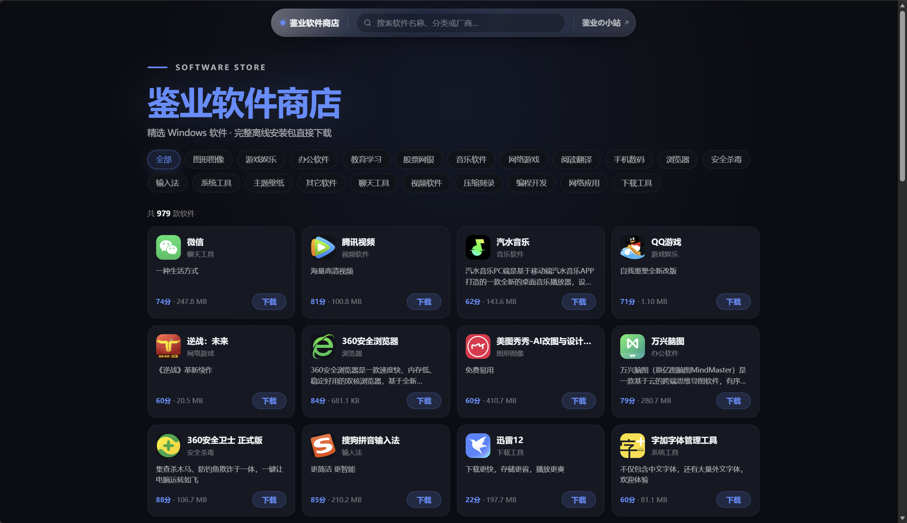

For a long time, there have been many inherent pain points in the software distribution link within the Windows ecosystem: the official distribution link bandwidth is unstable, a large number of service providers mainly promote lightweight online boot installers, the installation process bundles add-ons, and resources are scattered and difficult to manage in a unified manner. It is difficult for operation and maintenance personnel and individual users to quickly obtain trusted and complete offline installation media when reinstalling the system, batch deployment, or offline environment deployment. Based on this practical need, I independently developed and launched a new project - Appraisal Software Store.

The Jianye Software Store is implemented using a pure front-end web page architecture and does not rely on a dedicated client. It is different from the Microsoft App Store and various third-party software housekeepers that require local installation. Users can access the resource library through a browser only, retrieve software information, view version notes, and obtain installation packages. There is no need to register an account or log in for authentication, which lowers the access threshold and avoids problems such as resource occupation and background residency caused by the client itself.

**Project Design Concept**

The core positioning of the project is a Windows offline installation package aggregation and distribution platform. It does not pursue the accumulation of massive unfiltered resources, but directional screening and organization of applications that adapt to the Windows desktop. The project design focuses on three core goals: offline availability, efficient retrieval, and interference-free interface.

Give priority to providing complete offline media. Currently, many software officially distributes online downloaders (Bootstrap). This type of program itself is very small. After startup, it pulls the main program resources from the Internet in real time. It is easy to interrupt the installation in scenarios such as network packet loss, intranet isolation, and bandwidth restrictions. The resources included in the Jianye Software Store are mainly independent and complete offline installation packages. After the file download is completed, the installation can be performed independently without the Internet environment, adapting to scenarios such as system reinstallation, batch installation in computer rooms, intranet workstations, and weak network environments.

The platform focuses vertically on the Windows ecosystem. The resource library classification system is built around the needs of Windows users and is divided into categories such as system operation and maintenance tools, office productivity suites, multimedia processing tools, program development tools, network tools, and practical gadgets. Mobile and other operating system application resources are not mixed in. Supporting basic information fields: software name, version number, update time, applicable system architecture, and brief function description to facilitate users to quickly determine compatibility.

Lightweight, ad-free interactive design. The page structure is streamlined and optimized, and common third-party download site modes such as pop-up ads, jump inducements, and forced recommendations are abandoned. The logical level of the page is clear, focusing on the software list, details page, and download entrance. Priority is given to ensuring content loading speed and browsing experience.

**Target user group**

Desktop operation and maintenance engineers and installation enthusiasts: frequently deploy systems and need batch archiving and quick retrieval of commonly used software installation packages;

Users of intranet office and industrial control environments: The device restricts external network access and needs to pre-download the installation media in advance;

Developers: Collect development environment dependency tools and debugging tools, and manage versions in a unified manner;

Ordinary Windows users: hate bundled installation programs and want to directly obtain pure installation files to avoid additional software brought by online installation.

**Brief description of project technology implementation**

The project is built based on the web technology stack and adopts a solution based on static pages. The resource list is independently maintained and supports subsequent iterations to expand search and filtering, version archiving, update reminders and other capabilities. File storage adopts an independent resource hosting solution, and download links are distributed directly to reduce multi-layer transfer and improve download stability. The overall structure facilitates the continuous addition of software, removal of expired and invalid versions, and iteration of page interaction styles.

**Important Statement and Safety Instructions**

Jianye Software Store is a self-developed third-party resource aggregation and distribution project, and is not the official release channel of each software developer. The platform only organizes and distributes resources and does not participate in the development of the software itself.

For all downloaded installation packages, it is recommended to use anti-virus software and security detection tools to verify and scan, and then install after confirming that there are no abnormalities;

For commercially licensed software, please respect the intellectual property rights and license agreement of the original author, and give priority to official channels to purchase genuine licenses if conditions permit; cracked and modified versions of programs have high risks such as implanted backdoors, malicious code, and data theft, so it is recommended to screen carefully;

The platform will regularly clean up broken links and old and abandoned versions, but it is unable to audit the source code of all installation packages. The responsibility for security verification lies with the user;

> This project is only used as an alternative channel for software acquisition. The native official distribution source of software is always the choice with the highest security priority.

**Written at the end**

The project of starting the Jianye Software Store started from the resource acquisition problem that was repeatedly encountered during installation and operation. I hope to build a clean, lightweight warehouse focused on offline package distribution to solve the pain points of scattered resources and unstable online installation. The project is still continuing to iterate and optimize. In the future, it will continue to expand high-quality software resources, improve filtering functions, optimize distribution links, find a balance between convenience and security, and provide Windows users with a reliable resource alternative.
