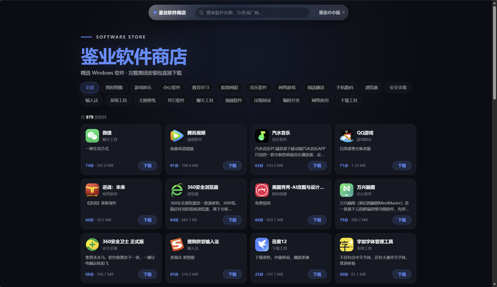

长期以来，Windows生态内软件分发链路存在诸多固有的痛点：官方分发链路带宽不稳定、大量服务商主推轻量在线引导安装程序、安装流程捆绑附加组件、资源分散难以统一管理，运维人员与个人用户在系统重装、批量部署、离线环境部署时，很难快速获取可信、完整的离线安装介质。基于这一现实需求，我独立开发并上线新项目——鉴业软件商店。

鉴业软件商店采用纯前端网页架构实现，不依赖专属客户端，区别于微软应用商店以及各类需要本地安装的第三方软件管家。用户仅通过浏览器即可访问资源库，检索软件信息、查看版本说明、获取安装包，全程无需注册账号、无需登录鉴权，降低接入门槛，规避客户端本身带来的资源占用、后台驻留等问题。

**项目设计理念**

项目的核心定位是 Windows离线安装包聚合分发平台，不追求海量无筛选资源堆砌，而是定向筛选、整理适配Windows桌面端的应用程序。项目设计围绕三个核心目标：离线可用、检索高效、界面无干扰。

优先提供完整离线介质 当前很多软件官方分发的是在线下载器（Bootstrap），这类程序本身体积很小，启动后实时联网拉取主程序资源，网络丢包、内网隔离、带宽限制场景下极易安装中断。鉴业软件商店收录资源以独立完整离线安装包为主，文件下载完成后，脱离互联网环境也可独立执行安装，适配系统重装、机房批量装机、内网工作站、弱网环境等场景。

平台垂直聚焦Windows生态 资源库分类体系围绕Windows用户需求搭建，划分为系统运维工具、办公生产力套件、多媒体处理工具、程序开发工具、网络工具、实用小工具等类目，不混入移动端、其他操作系统应用资源。配套基础信息字段：软件名称、版本号、更新时间、适用系统架构、简要功能说明，方便使用者快速判断兼容性。

轻量化、去广告的交互设计 页面架构做精简优化，摒弃弹窗广告、跳转诱导、强制推荐等常见第三方下载站模式。页面逻辑层级清晰，以软件列表、详情页、下载入口为主，优先保障内容加载速度与浏览体验。

**目标使用群体**

桌面运维工程师、装机爱好者：频繁部署系统，需要批量归档、快速调取常用软件安装包；

内网办公、工业控制环境使用者：设备限制外网访问，需要提前预下载安装介质；

开发人员：收集开发环境依赖工具、调试工具，统一管理版本；

普通Windows用户：厌恶捆绑安装程序，希望直接获取纯净安装文件，规避在线安装带来的附加软件。

**项目技术实现简述**

项目基于网页技术栈搭建，采用静态页面为主的方案，资源清单独立维护，支持后续迭代扩展检索筛选、版本归档、更新提醒等能力。文件存储采用独立资源托管方案，下载链路做直链分发，减少多层中转，提升下载稳定性。整体架构便于持续新增软件、下架过期失效版本、迭代页面交互样式。

**重要声明与安全须知**

鉴业软件商店属于个人自研的第三方资源聚合分发项目，并非各软件开发商官方发布渠道。平台仅做资源整理与分发，不参与软件本身的开发。

所有下载得到的安装包，建议使用杀毒软件、安全检测工具进行校验扫描，确认无异常后再执行安装；

商业授权类软件，请尊重原作者知识产权与许可协议，条件允许优先选择官方渠道购买正版授权；破解版、修改版程序存在植入后门、恶意代码、数据窃取等高风险，建议谨慎甄别；

平台会定期清理失效链接、老旧废弃版本，但无法做到对所有安装包做源码审计，安全校验责任由使用者自行承担；

> 本项目仅作为软件获取的备选渠道，软件的原生官方分发源，永远是安全性优先级最高的选择。

**写在最后**

启动鉴业软件商店这个项目，始于自身装机运维时反复遇到的资源获取难题。我希望搭建一个干净、专注离线包分发的轻量仓库，解决资源分散、在线安装不稳定的痛点。项目仍在持续迭代优化，后续会持续扩充优质软件资源、完善筛选功能、优化分发链路，在便利和安全之间寻找平衡，为Windows使用者提供一个可靠的资源备选方案。
